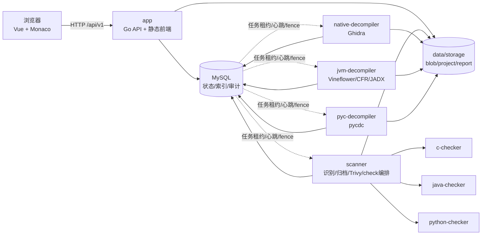
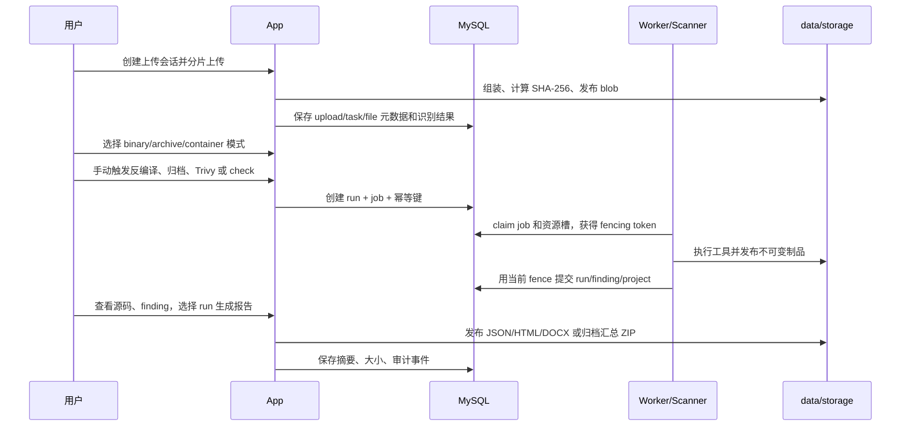

# BinaryScan 项目代码全模块讲解与 PPT 答疑手册

> 文档版本：V1.0
>
> 适用基线：`main` 分支当前实现
>
> 用途：项目汇报、代码走读、自主可控说明、现场演示准备和技术答疑
>
> 事实原则：本文只描述仓库中已经存在且能从代码、测试或交付脚本核对的能力；历史验收数字不等同于对任意文件的命中率或处理时长承诺。

## 0. 先记住这五句话

1. BinaryScan 是一个“上传样本—识别格式—由用户选择分析模式—反编译或镜像扫描—源码规则检查—生成报告”的多用户工作台。
2. 系统把 App、Scanner、三种反编译工具和三种源码检查器拆成 9 个长期容器，只有 App 对浏览器开放端口。
3. 上传后不会自动把所有分析都跑一遍；反编译、C/Java/Python 检查、Trivy 和报告都由用户按适用场景显式触发。
4. 原始文件、反编译源码、报告都持久化在 `data/` 对应目录，数据库保存身份、状态、索引和摘要；Monaco Editor 读取的不是临时目录。
5. 这不是“万能漏洞证明器”：反编译结果有信息损失，三个 checker 是结构化规则检查而非完整跨过程污点分析，Trivy 只适用于其能够识别的 Docker/OCI 镜像内容。

---

## 1. 三种时长的开场话术

### 1.1 30 秒版本

BinaryScan 是一个面向单位内网的二进制分析工作台。用户先上传文件，系统按内容识别真实格式，再由用户选择二进制、归档或容器映像流程。Native、JVM/Android 和 PYC 分别通过 Ghidra、Vineflower/CFR/JADX、pycdc 反编译，生成的类 C、Java 或 Python 源码可在 Monaco Editor 中查看，再由三个独立 checker 做规则检测。Docker Save 或 OCI TAR 可以手动用离线 Trivy 扫描。所有任务、源码、漏洞和报告都有持久化记录，并可离线部署或用封存源码现场重新构建 App。

### 1.2 3 分钟版本

BinaryScan 解决的不是单一“上传后跑一条命令”，而是把格式识别、重工具调度、源码留存、规则检测、报告和多用户权限连成可追溯流程。

入口统一接受 DLL、EXE、SYS、PYC、Mach-O、CLASS、JAR、APK、ZIP、RAR、TAR、GZIP、IMG、ISO、EXT4 等样本。服务端优先看魔数和内部结构，文件后缀只在 PYC、ZIP 应用包等少数歧义场景辅助判断。识别结果和用户分析模式分开：例如 TAR 既可能是普通归档，也可能是 Docker/OCI 镜像；ISO 和 EXT4 可以按只读归档遍历，但当前不能假装成 Trivy 支持的容器镜像。

运行层拆成 9 个容器：MySQL、App、Scanner、三个反编译 Worker、三个无状态 checker。MySQL 管状态，业务文件在 `data/storage`；任务通过数据库租约、心跳、资源槽和 fencing token 调度，避免 Worker 重启或超时后旧进程覆盖新结果。反编译源码发布到持久化 project，源码文件 ID、路径、SHA-256 和行列坐标再关联 finding，所以在线详情可以准确打开 Monaco。

交付分两套：`binary-deploy` 是九镜像直接离线运行包；`binary-demo` 额外封存 backend、frontend、App Dockerfile 和离线构建镜像，用户可先验哈希、断网构建 App、修改一个小功能、再次构建并只替换 App，从而证明源码一致性、可编译性和可修改性。

### 1.3 10 分钟版本的讲述顺序

1. 先讲用户流程和三种模式，不先陷入工具名。
2. 用九服务图解释为什么拆分能力边界。
3. 用一次 PYC 或 JAR 流程解释任务、源码、checker 和 Monaco。
4. 用 TAR/IMG/ISO/EXT4 解释“后缀不是格式”和“不适用不是零漏洞”。
5. 用租约、fencing、内容寻址和原子发布解释可靠性。
6. 用两套交付包解释离线部署与自主修改证明。
7. 最后主动说明检测边界，避免被问到时显得回避。

---

## 2. 总体架构



### 2.1 三个网络边界

| 网络 | 连接者 | 设计目的 |
|---|---|---|
| `edge-net` | App | 只让 App 承担浏览器入口；其他服务不发布宿主机端口。 |
| `database-net` | MySQL、App、Scanner、三个反编译 Worker | 需要持久化任务状态的服务访问数据库。 |
| `checker-net` | Scanner、三个 checker | Scanner 是 checker 唯一编排者；网络被标记为 internal。 |

对应代码：`docker-compose.yml`。

### 2.2 为什么不是一个“大而全”容器

- Ghidra、Java 反编译器、pycdc 和 Trivy 的运行时、体积、资源特征完全不同。
- 工具拆开后可按能力限制内存、进程数、挂载和并发槽。
- 某个 checker 停止只影响对应语言，不应阻塞归档、Trivy 或其他语言。
- 三个 checker 无数据库、无业务卷、无宿主机端口，减少误操作和权限面。
- App 现场修改时只需重建和替换 App，不必重做其他八个镜像。

代价也要承认：镜像数量、健康检查、日志和离线包体积会上升，所以项目用 Compose、统一脚本和镜像清单降低运维复杂度。

---

## 3. 仓库结构和职责

```text
binary/
├── app/
│   ├── backend/                 Go 后端、五个 Go 进程入口、迁移、API 契约
│   ├── frontend/                Vue 3、TypeScript、Pinia、Element Plus、Monaco
│   └── Dockerfile               App 多阶段构建
├── checkers/
│   ├── c/                       Java + ANTLR 的类 C 检查器
│   ├── java/                    JavaParser AST 检查器
│   └── python/                  Python 标准库 AST 检查器
├── deploy/
│   ├── docker/                  Scanner/反编译器 Dockerfile、固定镜像锁
│   ├── delivery/                两套交付包的跨平台脚本模板
│   └── scripts/                 构建、启动、备份、smoke、回归、交付生成
├── docs/                        架构、部署、验收、交付和本讲解手册
├── docker-compose.yml           九服务正式拓扑
├── .env                         本机正式参数和镜像标签
└── README.md                    项目入口说明
```

### 3.1 五个 Go 进程入口

| 入口 | 编译结果 | 主要职责 |
|---|---|---|
| `app/backend/cmd/app/main.go` | `binary-app` | HTTP API、前端静态资源、迁移和初始管理员引导。 |
| `cmd/scanner/main.go` | `binary-scanner` | 格式/归档/Trivy/checker 作业。 |
| `cmd/native-decompiler/main.go` | Native Worker | 只接受 Native 反编译 kind。 |
| `cmd/jvm-decompiler/main.go` | JVM Worker | 只接受 JVM/Android 反编译 kind。 |
| `cmd/pyc-decompiler/main.go` | PYC Worker | 只接受 PYC 反编译 kind。 |

这些入口复用 `internal/worker`、`internal/job` 和数据库协议，但每个最终镜像只携带自己的工具。

---

## 4. 九个长期服务逐一说明

| 序号 | 服务 | 做什么 | 不做什么 | 持久化/网络 |
|---:|---|---|---|---|
| 1 | `mysql` | 用户、会话、任务、run、job、finding、报告索引、审计 | 不存大文件正文 | `data/mysql`，仅 database-net |
| 2 | `app` | 登录、上传、任务 API、报告、内嵌 Vue | 不直接运行 Ghidra/Trivy/checker | `data/storage`，唯一对外端口 |
| 3 | `scanner` | 归档一层导入、Trivy、三个 checker 编排 | 不承担 JVM/Native/PYC 反编译 | blob/project/artifact + work |
| 4 | `native-decompiler` | Ghidra headless 输出类 C | 不做 C 漏洞规则检查 | blob 只读，写 projects/native |
| 5 | `jvm-decompiler` | CLASS/JAR 用 Vineflower/CFR，DEX/APK 用 JADX | 不做 Java 规则检查 | blob 只读，写 projects/jvm |
| 6 | `pyc-decompiler` | pycdc 输出 Python 或字节码降级结果 | 不做 Python 规则检查 | blob 只读，写 projects/pyc |
| 7 | `c-checker` | 对类 C 文本做结构化启发式规则检查 | 不连 DB、不读原始二进制 | 仅 checker-net |
| 8 | `java-checker` | 对 Java AST 做规则检查 | 不建立完整 classpath/跨项目语义 | 仅 checker-net |
| 9 | `python-checker` | 对 Python AST 做规则检查 | 不执行源码、不做跨模块污点 | 仅 checker-net |

### 4.1 容器加固基线

`docker-compose.yml` 对产品服务统一设置：只读根文件系统、非 root UID/GID、删除 capabilities、`no-new-privileges`、受限 tmpfs、日志轮转、内存和 PID 限制。具体挂载按最小职责添加。

这不是“容器绝对安全”的宣称，而是把常见权限和持久化面收窄；目标主机仍要配置受控内网、防火墙和 Docker daemon 权限。

---

## 5. 一条完整业务流程



关键点：上传完成只表示“文件已安全保存并识别”；不表示所有分析已经自动执行。

---

## 6. 配置、启动和数据库迁移

### 6.1 配置加载

`app/backend/internal/config/config.go` 是五个 Go 进程的统一配置入口。配置分为：

- `Database`：连接 MySQL；
- `App`：监听地址、公开地址、Origin、初始管理员、存储和上传上限；
- `Worker`：工作目录、工具路径、归档上限、租约/心跳和各资源池槽数。

统一结构不等于所有容器都获得全部变量。Compose 只给角色注入必要参数；checker 根本不使用这份 Go 配置。

### 6.2 数据库初始化

`internal/database/database.go`：

- 使用 MySQL 9 兼容驱动，UTC 时间和 `utf8mb4`；
- 设置连接池上限、空闲连接和连接寿命；
- 启动时先 Ping；
- 迁移前获取 MySQL advisory lock，避免多个实例同时迁移；
- 按数字前缀顺序执行内嵌 SQL；
- 每个迁移和 `schema_migrations` 记录在同一事务提交。

迁移文件位于 `app/backend/migrations/`，当前从基线表逐步加入发布状态、输入类别、源码制品、报告幂等、分析模式和归档总报告。

### 6.3 初始管理员语义

App 只在数据库没有管理员时使用环境变量创建初始管理员。之后修改 `.env` 不会覆盖数据库里已存在的账号密码。交付脚本为 `binary-demo` 和 `binary-deploy` 分别随机生成初始密码，保存在权限收敛的 `.env` 中。

---

## 7. HTTP、鉴权和审计

主路由在 `app/backend/internal/app/server.go`。

### 7.1 路由分层

- 公开：`/healthz`、`/readyz`、系统信息、登录；
- 已认证只读：任务、事件、finding、源码、报告、归档批次；
- operator 变更：上传、创建任务、反编译、检查、Trivy、报告；
- administrator：用户和审计管理。

### 7.2 安全控制

- HttpOnly 会话 cookie；
- 状态变更请求要求 CSRF；
- 非只读方法检查配置的 Origin；
- reader/operator/administrator 做最小角色校验；
- 管理员变更有被拒绝和成功审计；
- 用户角色/密码/停用发生变化时撤销相关会话；
- 请求 ID 在响应回传，便于关联日志；
- API 404 保持 JSON，不被 SPA fallback 掩盖。

### 7.3 不应夸大的地方

项目当前入口是 HTTP，设计前提是单位受控内网和防火墙。仓库不应被描述为“自带公网零信任网关”或“端到端 TLS 产品”；如需公网或 TLS，应在受控反向代理、证书和额外安全评审后部署。

---

## 8. 分片上传、内容寻址和幂等

核心代码：`internal/app/uploads.go`、`internal/storage/blob.go`。

### 8.1 为什么使用上传会话

- 大文件按 part 上传，避免一个长 HTTP 请求失败后全部重传；
- `Content-Range`、总大小、part 编号和 SHA-256 都要校验；
- 幂等键让客户端重试创建或完成操作时复用同一结果；
- assembly token 防止两个完成请求同时组装；
- 完成阶段再次核对 part 连续性、总大小和整文件摘要。

### 8.2 BlobStore 的设计

原始内容进入 `data/storage/blobs` 时：

1. 读取时限制 `maxBytes + 1`，多一个字节用于可靠判断超限；
2. 单次流式计算 SHA-256；
3. 写入同文件系统私有暂存文件；
4. 通过硬链接/原子方式发布到由摘要推导的路径；
5. 设置只读；
6. 并发上传相同内容时校验并复用已有 blob。

数据库保存 storage key、大小、摘要和业务归属，不把大文件塞进表中。

### 8.3 为什么仍要保存任务级元数据

相同 blob 可以被不同用户、文件名或归档批次引用。内容去重不能替代权限、审计、原始逻辑路径和任务生命周期，因此 blob 与 task/file node 是两层概念。

---

## 9. 格式识别与分析模式

核心代码：`internal/filetype/detect.go`、`internal/containerarchive/inspect.go`。

### 9.1 “识别类别”与“用户模式”为什么分开

- 识别类别是服务端根据内容给出的事实/推荐；
- 分析模式是用户决定要尝试的工作流；
- 多义文件不应仅凭后缀被强制塞进一个流程；
- 不适用任务要明确显示，不应伪装成“检测成功且零漏洞”。

### 9.2 主要路由矩阵

| 实际内容/格式 | 二进制模式 | 归档模式 | 容器/映像模式 |
|---|---|---|---|
| PE32/PE32+、ELF、Mach-O | Ghidra | 通常不适用 | 不适用 |
| CLASS/JAR/WAR/EAR | Vineflower，必要时 CFR | JAR/WAR/EAR 可按 ZIP 一层展开 | 不适用 |
| DEX/APK | JADX | APK 可按 ZIP 一层展开 | 不适用 |
| PYC | pycdc | 通常不适用 | 不适用 |
| ZIP/7Z/RAR/TAR/GZIP/XZ/DEB/RPM | 取决于内部单文件，不作为普通入口 | 一层遍历、选择成员创建子任务 | 普通归档不适用 |
| Docker Save TAR | 不适用 | 可按 TAR 查看一层，但不是主要容器分析 | 手动 Trivy |
| OCI Image Layout TAR | 不适用 | 可按 TAR 查看一层 | 手动 Trivy |
| 改名为 `.img` 的 Docker/OCI TAR | 由内部结构识别，不按后缀猜 | 同上 | 手动 Trivy |
| ISO 9660 | 不作为 Native 可执行文件 | 只读一层遍历，可拆出 ELF/PE 等 | Trivy 不适用 |
| EXT4 文件系统镜像 | 不直接交给 Ghidra | 只读一层遍历，可拆出 ELF/PE 等 | Trivy 不适用 |

### 9.3 IMG 到底是什么

`.img` 只是通用扩展名，不是一种唯一内部格式。它可能是：

- Docker save TAR 改名；
- OCI TAR 改名；
- EXT4/raw 磁盘镜像；
- 其他完全不支持的内容。

代码先检查 PE/ELF/DEX/CLASS/Mach-O/ZIP/PYC/压缩格式/ISO/DEB/TAR 容器结构，再检查 EXT 超级块。Docker/OCI TAR 即使改名 `.img` 仍可按结构识别；未知 IMG 不会因为后缀自动获得 Trivy 能力。

### 9.4 Docker TAR 的结构验证

`InspectTAR` 不以存在一个同名 JSON 就下结论：

- Docker save 要有可解析的 `manifest.json`；
- manifest 引用的 config 和每个 layer 必须真实存在；
- OCI 要有 `oci-layout`、`index.json`、schemaVersion 和 blob 结构；
- 元数据和总条目都有上限；
- layer 正文在识别阶段不展开到内存。

---

## 10. 归档一层拆分

核心代码：`internal/extract/walk.go`、`internal/scanner/archive.go`。

### 10.1 支持的读取器

- ZIP；
- 7Z；
- RAR；
- TAR；
- GZIP、XZ 及其 TAR 包装；
- DEB（ar + tar 成员）；
- RPM（cpio payload）；
- JAR/WAR/EAR/APK 按 ZIP；
- ISO 9660；
- EXT4。

“支持读取”不等于所有归档都必然能创建二进制子任务。系统只把识别为支持二进制格式的成员列为可创建任务对象。

### 10.2 为什么只展开一层

- 防止 ZIP bomb 和递归嵌套导致不可控 CPU、磁盘和任务数量；
- 用户能看清本次批量创建的直接来源；
- 二层归档仍可作为一个成员任务后由用户再次处理；
- 验收口径稳定，不会因深层结构自动生成海量任务。

`.tar.gz` 的压缩包装和 TAR 本体算一个逻辑层；TAR 内再次出现 ZIP 不会自动递归。

### 10.3 资源和路径防护

- 限制条目总数；
- 限制累计展开字节；
- 检查 context 取消；
- 统一清洗 `/`、`\`、`..`、绝对路径；
- 处理重复逻辑路径；
- ISO/EXT4 使用只读 Go 文件系统后端，不挂载到宿主机；
- 成员进入 blob 时再次受单文件大小限制。

### 10.4 父批次和子任务

归档导入保存父文件、import、entry 和子任务关系。每个子任务具有独立 task、run、project、finding 和报告，所以可以分别反编译、检测和导出。删除外层上传显示状态不应抹掉已经存在的批次关系和报告。

---

## 11. 任务队列、租约、心跳、资源槽与 fencing

核心代码：`internal/job/repository.go`、`internal/job/types.go`、`internal/worker/worker.go`。

### 11.1 为什么不用进程内队列

重工具运行可能持续较久，容器会重启，系统也可能有多个 Worker。如果队列只在内存里：

- App 重启会丢任务；
- 无法统一限制跨进程并发；
- 旧 Worker 和新 Worker 可能同时发布同一任务；
- 失败和审计记录不完整。

因此 job、attempt、run、资源槽和租约都持久化在 MySQL。

### 11.2 领取流程

1. Worker 用允许的 kind 列表轮询；
2. 事务中用 `FOR UPDATE SKIP LOCKED` 选择可运行 job；
3. 同事务锁定对应资源池的空闲 slot；
4. 递增 fencing token，写入 owner 和 lease_until；
5. job 和 slot 任一失败则事务回滚。

这避免“任务有租约但没配额”或“槽被占用但没有任务”。

### 11.3 Heartbeat 和 lease

运行期间独立心跳续租。只有 owner、token 和尚未过期的租约同时匹配才可续期；租约过期后不能被旧 Worker 复活。

### 11.4 Fencing token 解决什么

场景：Worker A 卡顿，租约过期；Worker B 重新领取并开始执行；此时 A 又恢复。如果只看 job ID，A 可能把旧结果覆盖 B。每次领取递增 token 后，所有完成和发布操作都要求当前 token，所以 A 的迟到提交得到 `ErrFenceLost`。

### 11.5 发布提交点

Worker 把工具输出先发布为不可变文件，再在带 fence 的事务中登记 project/finding/artifact 和完成状态。恢复逻辑会识别 `published_at`：如果文件和索引已经发布但 finish 前崩溃，可收敛状态而不是重复运行重工具。

### 11.6 资源池

| Pool | 对应 kind |
|---|---|
| scanner | scan、archive_import |
| trivy | trivy_scan |
| native | native_decompile |
| jvm | jvm_decompile |
| pyc | pyc_decompile |
| c-check | c_check |
| java-check | java_check |
| python-check | python_check |

槽位是数据库记录，可在多 Worker 场景共享全局预算。缩容时只禁用空闲多余槽，不强行打断已占用槽。

---

## 12. 三条反编译链路

核心代码：`internal/decompiler/executor.go` 和 `app/backend/tools/ghidra/ExportPseudoC.java`。

### 12.1 Native：Ghidra

适用：PE（EXE/DLL/SYS）、ELF、Mach-O。

流程：

1. Worker 从内容寻址 blob 读取原始文件；
2. 创建私有 work 目录；
3. 调用 Ghidra `analyzeHeadless`；
4. 自定义脚本按函数导出类 C 文本；
5. 校验输出路径、文件数、大小和 UTF-8；
6. 发布到 `projects/native` 并登记 source files。

类 C 不是原作者源码：变量名、类型、宏、注释和控制结构可能丢失或被重构。演讲时应说“反编译伪代码/类 C 源码”，不要说“恢复原始 C 工程”。

### 12.2 JVM：Vineflower、CFR、JADX

- CLASS/JAR：先 Vineflower；失败时尝试 CFR，并将质量标为 `partial_source`；
- DEX/APK：使用 JADX 输出 Java；
- JAR 可能产生多个 Java 文件；
- 缺失依赖、混淆、版本或损坏字节码会影响质量。

为什么保留降级：不同反编译器对异常字节码的容忍度不同。降级提升“得到可检查文本”的概率，但不能把 partial 当完整源码。

### 12.3 PYC：pycdc

- 对支持的 Python 字节码尝试输出 `.py`；
- pycdc 非零退出但已产生有效文本时可保留并标 `partial_source`；
- 若只有字节码表示或没有可解析 Python，质量可为 `bytecode_only`；
- `bytecode_only` 不能进入 Python AST checker。

PYC 与 Python 版本关系紧密，不能承诺任意年代、任意实现的 PYC 都能恢复为 AST 可解析源码。

### 12.4 外部工具执行边界

- 每类工具有超时；
- `HOME`、临时目录、工作目录指向私有路径；
- 不把用户文件名直接拼成任意命令；
- 输出路径必须位于预期根下；
- 日志长度受限；
- 只有校验过的 UTF-8 文件进入 source project。

---

## 13. 三个源码 checker

共同 HTTP 契约位于 `app/backend/api/checker-v1.yaml`。Scanner 读取已发布 project，批量发送源码；checker 返回 finding 和 diagnostic；Scanner 再验证路径、坐标、数量和响应身份后持久化。

### 13.1 C checker

位置：`checkers/c`。实现：Java 21 + ANTLR lexer + 针对 Ghidra 类 C 的 token/符号启发式。

代表性规则族：

- `gets`、不受限复制、无界 `%s`；
- 非字面量格式串；
- `system`/`popen` 非字面量命令；
- 不安全临时文件 API；
- 弱摘要/弱密码；
- 忽略关键返回值；
- offset pointer/free 非堆内存；
- `sizeof(pointer)` 分配错误；
- 过宽文件权限；
- 常量可判定的越界读写；
- 返回栈地址；
- 常量零除数。

为什么不是完整 C 编译：Ghidra 输出经常缺少标准头、宏、完整类型和可编译工程结构。使用真实 C 编译器前端会把大量反编译语法问题当失败，因此这里选择对伪代码更容忍的结构化 token 分析。

### 13.2 Java checker

位置：`checkers/java`。实现：JavaParser AST + `ExpressionFacts` 的局部常量/赋值事实。

代表性规则族：

- 弱 MessageDigest、弱 Cipher、旧 TLS；
- 硬编码密钥；
- trust-all hostname/X509；
- XXE；
- Java 反序列化；
- SQL 注入和命令执行；
- 动态代码执行；
- 过宽文件权限；
- 不安全 Cookie。

边界：没有构建完整 classpath、类型求解和跨方法调用图。局部表达式事实能减少纯字符串拼接场景的漏报，但不能宣称完整企业级 SAST 污点引擎。

### 13.3 Python checker

位置：`checkers/python/src/checker.py`。实现：标准库 `ast.NodeVisitor`。

代表性规则族：

- `eval`/`exec` 动态执行；
- `os.system`、`subprocess` 命令执行；
- pickle/shelve/yaml 反序列化；
- MD5/SHA1；
- requests `verify=False`；
- import alias 和 from-import 解析；
- pycdc 某些 keyword 展开形式兼容。

Python AST 的列是 UTF-8 字节偏移，Monaco 使用 UTF-16 code unit；代码显式转换，避免中文或 emoji 前面的定位漂移。

### 13.4 共同输出原则

- 行列是一基坐标；
- finding 含 rule、severity、CWE、路径、标题、消息和 evidence；
- 同规则同坐标去重；
- 稳定排序；
- 单个文件解析失败形成 diagnostic，不应掩盖其他文件结果；
- 设定文件、请求字节、finding 和 diagnostic 上限。

### 13.5 如何解释误报和漏报

正确说法：结果是基于反编译文本和规则条件的风险线索，需要结合调用上下文、输入可控性和运行环境人工复核。不要把“finding 数量”直接等同于“真实可利用漏洞数量”。

---

## 14. Trivy 容器镜像分析

Trivy 由 Scanner 镜像携带，使用制备时封装的离线数据库和 Java 数据库，运行时禁止数据库更新。

### 14.1 适用输入

- Docker Save TAR；
- OCI Image Layout TAR；
- 内容实际是上述结构但后缀改成 `.img` 的文件。

### 14.2 不适用输入

- 普通 TAR；
- ISO 9660；
- 原始 EXT4；
- 只有 `.img` 后缀但内部不是 Docker/OCI 的文件；
- 任意普通 EXE/JAR/PYC。

当前系统没有把 raw rootfs/EXT4 物化为 Trivy rootfs 输入的流程。因此 ISO/EXT4 选择容器模式时应显示不适用/无结果，不应伪造扫描。

### 14.3 为什么手动触发

- 文件多义，用户要先确认分析意图；
- Trivy 较重，自动对所有上传运行会浪费资源；
- 明确区分格式识别和漏洞扫描；
- 验收日志能说明是谁、何时、对哪个 file node 发起检测。

### 14.4 结果边界

Trivy 结果取决于离线数据库时间、镜像内软件清单和支持的生态。零结果可能代表无匹配、数据库范围外或不适用，不能直接推导“镜像绝对安全”。

---

## 15. 源码项目、Source File 与 Monaco Editor

核心代码：`internal/storage/publisher.go`、`internal/app/artifacts.go`，前端 `ReadOnlyCodeEditor.vue`、`DecompileResultWorkspace.vue`、`TaskDetailPanel.vue`。

### 15.1 为什么源码必须持久化

- checker 请求需要稳定输入；
- finding 要能在任务详情定位；
- 报告生成时要读取相同版本；
- 容器重启后仍能查看；
- 归档总报告可选复制已经发布的源码。

临时 work 目录可以清理，published project 不可以当缓存随意删除。

### 15.2 发布结构

- Project 有 ID、语言、工具、质量、根路径、run 归属；
- Source file 有稳定 ID、project ID、相对路径、大小、SHA-256、语言；
- 项目先在 staging 校验，再以目录 rename 原子发布；
- manifest 固化文件清单；
- 数据库只接受当前 fencing token 的发布。

### 15.3 在线跳转如何工作

finding 保存 `sourceProjectId`、`sourceFileId`、路径和起止行列。前端把跳转意图放入 URL query，切到结果页签并等待异步 Monaco 组件挂载，然后按 ID 获取源码，校验身份并定位。

使用 ID 而不是把本机文件路径放进 URL，是因为浏览器无法访问容器或服务器磁盘路径，也能避免用户拼接任意路径读取文件。

### 15.4 离线 HTML 为什么没有“在源码中打开”链接

下载后的 HTML 通过 `file://` 打开时，`/tasks/...` 只是本地文件系统路径，不可能自动连接真实 App。当前报告保留源码路径、行列、片段和证据，但删除依赖在线路由的伪链接。这是准确性修正，不是能力退化。

### 15.5 Monaco 模型生命周期

前端为项目/文件建立模型身份；切换文件时复用或释放模型，防止长时间浏览大量反编译文件导致内存持续增长。路由变化和异步响应使用 generation/identity 校验，避免上一任务的迟到响应覆盖当前文件。

---

## 16. Finding、报告和归档总报告

核心代码：`internal/app/reports.go`、`report_render.go`、`archive_reports.go`。

### 16.1 单任务报告

支持：

- JSON：机器可读，schema `binaryscan-report-v3`；
- HTML：可离线浏览、打印；
- DOCX：适合验收归档和 Word 阅读。

报告不是“当前任务所有东西自动拼接”，而是用户显式选择终态 run 的不可变快照。这样能解释某份报告到底包含哪次反编译、哪次 check 或哪次 Trivy。

### 16.2 报告生成一致性

- 请求格式和 run ID 规范化；
- Idempotency-Key 对应同一生成意图；
- 只接受属于该任务且终态的 run；
- 先写文件并算大小/SHA-256，再登记数据库；
- 提交结果不确定时回读幂等记录；
- 下载前验证类型、大小和摘要；
- 响应 ETag 使用已保存摘要。

### 16.3 HTML/DOCX 的信息布局

当前版包含：封面/标题、执行摘要、识别信息、运行清单、严重性统计、漏洞明细、源码位置、片段、证据和诊断。0 finding 的终态运行也能生成报告；单份报告最多选择 100 个 run，finding 超过 50,000 条时会明确标记截断。HTML 有打印样式，DOCX 使用 WordprocessingML 样式，不依赖运行时调用 Pandoc。

### 16.4 归档总报告 ZIP

一个归档批次可以包含多个子任务。总报告按“每个子任务、每种所选格式取最新 ready 报告”收集：

- `manifest.json`：机器可读完整清单，记录缺失格式、运行和省略原因；
- `index.html`：人可读索引，展示已包含/已省略任务及报告链接；
- `tasks/<子任务>/...`：报告文件；
- 可选反编译源码；
- 明确列出缺少所选格式和完全未收录的任务。

总报告不会暗中启动反编译、checker 或单报告生成。生成当时没有 ready 的内容会在 manifest 中记录为缺失/省略；至少需要一份符合所选格式的 ready 报告。

### 16.5 为什么总包要复验文件

写 ZIP 前再次核对 storage key、大小和 SHA-256；路径转为跨平台安全相对路径；总大小有 4 GiB 边界。这样避免数据库索引与磁盘文件不一致时生成看似成功但内容错误的包。

---

## 17. 前端实现

技术栈：Vue 3、TypeScript、Vite、Pinia、Vue Router、Element Plus、Monaco Editor。

### 17.1 路由和会话

- `src/router/index.ts`：登录保护、角色页面和懒加载；
- `src/stores/session.ts`：只保存当前会话状态，不持久化密码；
- `src/api/live/client.ts`：统一请求、CSRF、错误转换、游标和契约适配。

### 17.2 统一上传工作区

`UnifiedUploadWorkspace.vue` + `useUnifiedUpload.ts`：

- 本地预检扩展名和大小只用于用户提示，服务端仍做权威识别；
- 创建上传会话、分片、重试、完成；
- 上传成功或失败后清理本次临时表单，避免新建页保留历史任务；
- 完成识别后再呈现分析模式；
- 幂等重试避免重复创建。

### 17.3 归档批次

- `useArchiveImport.ts`：归档状态和成员分页；
- `useArchiveReportBundles.ts`：总报告请求、轮询和下载；
- UI 默认筛选、已选成员和任务创建状态彼此分离。

### 17.4 任务实时状态

- `useTaskEvents.ts`：SSE、Last-Event-ID/游标、断线续传和退避；
- `TaskDetailPanel.vue`：把事件局部合并后再拉权威详情；
- 使用 generation 拒绝任务切换后的迟到响应；
- 专项事件只刷新相应结果域，避免每条日志重载全页；
- 执行日志去重并限制内存条数。

### 17.5 结果工作区

- 反编译：项目树、文件内容、质量和下载；
- C/Java/Python：finding、严重性、源文件跳转；
- Trivy：漏洞列表和元数据；
- 报告：选择 run 和格式、生成状态和下载；
- 页面状态区分 loading、empty、failed、not-applicable 和 ready。

### 17.6 为什么前端不能自己“判断真实格式”

浏览器扩展名预检只能改善交互，不能承担安全或权威路由。文件可以改名，复杂 ZIP/TAR 需要结构检查；最终格式和模式适用性来自后端。

---

## 18. 数据目录和一致性

正式数据根由 `BINARY_DATA_ROOT` 指定，交付包固定为自身 `./data`。

```text
data/
├── mysql/                       MySQL 数据文件
├── storage/
│   ├── blobs/                   按 SHA-256 的原始内容
│   ├── projects/
│   │   ├── native/              Ghidra 类 C
│   │   ├── jvm/                 Java
│   │   └── pyc/                 Python/降级文本
│   ├── artifacts/               Worker 结果制品
│   └── reports/
│       └── archive-bundles/     归档总报告
└── work/                        可重建的运行暂存
```

### 18.1 什么必须备份

- `data/mysql`；
- `data/storage`。

两者必须是一致性时点。只备份数据库会丢源码/报告正文；只备份 storage 会丢权限、任务和索引。`deploy/scripts/data.sh backup` 采用停写备份：暂停写入服务、保持 MySQL 供 dump、归档 storage，再恢复原运行状态。

### 18.2 什么可以重建

- `data/work`；
- Docker 日志；
- 构建缓存。

但“可重建”不代表可在任务运行中随意删除；应先停止相应服务。

### 18.3 reset 的语义

`manage.sh reset --yes` / `manage.ps1 reset -Yes` 会永久清空交付目录内的 `data` 并重新初始化。脚本验证绝对路径、哨兵、项目名以及符号链接/junction，降低删错目录风险。日常重启应使用 stop/start/restart，不用 reset。

---

## 19. 构建与供应链

### 19.1 正式构建

`deploy/scripts/release.sh` 构建：

- App；
- Scanner；
- Native/JVM/PYC 三个 decompiler；
- C/Java/Python 三个 checker。

MySQL 使用锁定的官方镜像。所有最终镜像固定目标 `linux/amd64`。

### 19.2 工具基础镜像

制备机提前准备并固定：

- Ghidra runtime；
- JVM 反编译工具；
- pycdc tools；
- Trivy runtime + 离线 DB；
- Go/Node/Java/Python/Distroless 基础镜像。

产品启动使用 `pull_policy: never`，交付运行不依赖镜像仓库。

### 19.3 为什么锁镜像还不能保证字节级可复现

同源码、同依赖和同基础镜像能显著提高可复验性，但 Docker builder、文件系统、时间元数据和构建实现可能让最终 image ID 不同。自主验收的合理证明是：

- 输入源码哈希一致；
- 依赖锁摘要一致；
- 构建网络为 none；
- 构建成功并能启动；
- 修改后源码摘要和 App 镜像变化；
- 其他八个运行镜像保持不变。

不要承诺不同主机生成完全相同的镜像 ID。

---

## 20. 两套交付目录

### 20.1 `binary-deploy`

用途：直接离线部署。

包含：

- 九个运行镜像归档和归档 SHA-256；
- `docker-compose.yml`；
- 随机口令 `.env`；
- Windows PowerShell 与 Linux/macOS Shell 的 verify/load/manage；
- `manifests/package.sha256`；
- 空 `data/`。

典型顺序：验 package 清单自身可信锚点 → load images → 修改现场地址 → init/doctor/start → 业务验收。

### 20.2 `binary-demo`

用途：源码封存、自主构建和现场修改证明。

在 direct 内容基础上增加：

- `app/backend`；
- `app/frontend`；
- App Dockerfile 和 `.dockerignore`；
- `build-app.sh/.ps1`；
- 离线 App 构建镜像；
- `source.sha256`、`source-git.txt`、运行/构建镜像清单；
- `build-output/`。

### 20.3 生成脚本的关键保证

`deploy/scripts/create-deliveries.sh`：

- 如果 `app/backend` 或 `app/frontend` 有未提交改动则拒绝封存；
- 用 `git archive HEAD` 提取源码，不抄工作树；
- `source-git.txt` 记录 commit 和 branch；
- source manifest 覆盖封存源码；
- package manifest 排除运行后可变的 `data/` 和 `build-output/`；
- 两套目录使用不同随机数据库/管理员密码；
- runtime images 只导出一次再复制，减少制备空间；
- 先在临时 stage 完成，再移动为最终目录。

### 20.4 Windows 现场要点

- Docker Desktop 使用 Linux containers + WSL2；
- 正式目标为 x64/AMD64；
- 建议本机 NTFS 短路径，不放 OneDrive/网络盘/压缩包内；
- PowerShell 使用 `*.ps1`，不要同一轮混用 WSL Shell；
- 需要时仅对当前窗口设置 ExecutionPolicy Bypass；
- Apple Silicon/macOS 可模拟 AMD64用于制备或演示，但不作为高负载生产承诺。

---

## 21. 测试与验收证据

### 21.1 代码级测试

| 范围 | 命令 | 主要覆盖 |
|---|---|---|
| Go 后端 | `cd app/backend && go test ./...` | 路由服务、识别、归档、容器结构、反编译适配、scanner、storage 等 |
| Vue | `npm test` | 上传契约、归档报告、API 元数据、预检、分页等 |
| Vue 构建 | `npm run build` | TypeScript、Vue SFC 和生产 Vite 构建 |
| C checker | `cd checkers/c && mvn test` | 代表性危险/安全形式和坐标 |
| Java checker | `cd checkers/java && mvn test` | AST 规则和回归 |
| Python checker | `python3 -m unittest discover -s tests -v` | 规则、别名、pycdc、语法部分失败和 UTF-16 坐标 |

### 21.2 发布 smoke

`deploy/scripts/smoke.sh`：

- `topology`：静态验证恰好九服务、网络、端口、变量和挂载边界；
- `contracts`：对三个 checker 发送真实 `checker-v1` 请求；
- `live`：上传 PYC，确认没有自动分析 run，再手动 pycdc、Python check 和 JSON 报告。

### 21.3 工具回归

- `decompiler-checker-regression.sh`：覆盖 EXE、DLL、SYS、ELF、Mach-O、CLASS、JAR、DEX、APK、PYC，比较预期规则族；
- `trivy-image-regression.sh`：Docker Save TAR、Docker archive 改名 IMG、OCI TAR；
- `binary-repo/01-binary/expected-findings.json` 等 fixture 清单作为稳定预期。

### 21.4 验收数字怎么讲

可以说“某次制备机对固定样本完成了多少项”，同时必须带上日期、样本集和环境。不能把固定 fixture 的命中数量宣传成对任意用户文件的保证。

---

## 22. 关键设计取舍

### 22.1 手动分析而不是全自动流水线

优点：用户意图明确、资源可控、不适用状态清晰、审计可读。缺点：操作步骤更多。当前产品选择适合验收和人工分析的显式流程。

### 22.2 数据库队列而不是消息中间件

任务、状态、租约和业务事务都在 MySQL，减少额外 Kafka/Redis/RabbitMQ 服务和离线镜像。代价是要自己严谨实现 claim、lease、fencing 和恢复；代码已经围绕这些一致性问题设计。

### 22.3 内容寻址而不是用户路径存储

消除路径穿越作为物理存储键、支持去重和完整性复验。代价是必须用数据库维护逻辑文件名和所有权。

### 22.4 原子发布而不是直接写最终目录

消费者只看到完整 project/report/blob，避免半写文件。代价是需要 staging、同文件系统和提交恢复逻辑。

### 22.5 checker 独立服务而不是嵌入 Scanner

隔离语言实现、依赖和故障；Scanner 统一做持久化与重试。代价是内部 HTTP 和契约维护。

### 22.6 一层归档而不是无限递归

优先可控资源和可解释父子关系。若未来要多层，需要新增全局深度、总展开量、总任务数、循环摘要和 UI 来源链，不只是改一个递归开关。

---

## 23. 能力边界清单

### 23.1 可以明确说“已实现”

- 多用户登录、角色和审计；
- 分片上传、摘要、格式识别、模式选择；
- PE/ELF/Mach-O、CLASS/JAR、DEX/APK、PYC 三类反编译；
- ZIP/7Z/RAR/TAR/GZIP/XZ/DEB/RPM/JAR/APK/ISO/EXT4 一层读取；
- Docker/OCI TAR 的手动离线 Trivy；
- C/Java/Python 三个结构化规则 checker；
- 源码持久化和 Monaco 定位；
- JSON/HTML/DOCX 单任务报告；
- 归档批次总报告 ZIP；
- MySQL 租约队列、资源槽、心跳和 fencing；
- Windows/Linux/macOS 双脚本交付；
- backend+frontend 封存、验哈希、断网重建 App、现场修改再构建。

### 23.2 不应宣称

- 还原原作者完整源码；
- 任意二进制、任意 PYC 版本都能反编译；
- 三个 checker 是完整跨过程/跨模块污点 SAST；
- Trivy 能扫描 ISO、EXT4 或任意 IMG；
- 零 finding 等于没有漏洞；
- 离线数据库包含发布日之后的漏洞；
- 不同主机的镜像 ID 字节级完全一致；
- 系统自带公网 TLS/WAF/零信任能力；
- 当前 `binary-demo` 已封存 Scanner、decompiler 和 checker 的全部源码构建链。实际情况是：`app/backend` 中确实包含 Scanner 和三个反编译 Worker 的 Go 入口/共享包，但自主构建包只提供 App Dockerfile 与 App 离线依赖；专用 Worker Dockerfile、工具供给和 `checkers/` 源码没有进入该现场构建范围。

---

## 24. 建议 PPT 结构与逐页话术

### 第 1 页：项目定位

标题：BinaryScan 二进制分析与可追溯报告工作台。
一句话：把不同二进制工具整合成多用户、可持久化、可验收的流程。

### 第 2 页：用户问题

- 文件类型多、后缀可伪造；
- 反编译工具链差异大；
- 输出不持久化就无法复核；
- 重工具需要并发和故障恢复；
- 验收要求离线部署和源码自主修改证明。

### 第 3 页：三种分析模式

用二进制/归档/容器三栏图。强调识别后用户选择，TAR/IMG 由内容判断。

### 第 4 页：九服务架构

展示本手册 Mermaid 图。重点说只有 App 暴露端口，checker 无数据库和卷。

### 第 5 页：上传和格式识别

讲分片、SHA-256、CAS、魔数/结构识别、幂等。演示改名 IMG 仍按 Docker TAR 识别。

### 第 6 页：归档一层拆分

讲格式矩阵、ISO/EXT4 只读、一层边界、子任务独立。

### 第 7 页：三条反编译链

Native→类 C，JVM/Android→Java，PYC→Python。明确“类源码”与质量级别。

### 第 8 页：三个 checker

讲 C token/ANTLR、Java AST、Python AST；各列 3 个代表规则，不堆全部规则。

### 第 9 页：Trivy

讲 Docker/OCI TAR、离线数据库、手动触发和 ISO/EXT4 不适用。

### 第 10 页：可靠任务队列

用 lease—heartbeat—fencing 时间线解释容器重启后为什么不会乱写。

### 第 11 页：源码与 Monaco

展示 project/file ID、SHA、坐标到编辑器；说明离线 HTML 去掉伪链接。

### 第 12 页：报告

JSON/HTML/DOCX + 归档总报告 ZIP；强调用户选择终态 run 和缺失清单。

### 第 13 页：安全与权限

角色、CSRF、Origin、会话撤销、审计、最小容器权限、内网部署边界。

### 第 14 页：数据与备份

数据库存状态、storage 存正文；两者一致性备份；work 可重建。

### 第 15 页：离线交付

对比 binary-deploy 与 binary-demo，展示 package/source hash 可信锚点。

### 第 16 页：自主修改证明

验源码→断网构建→运行→改 UI/API→再构建→只换 App→证据对比。

### 第 17 页：测试证据

列单测、checker contract、工具 fixture、交付校验，不把历史数字扩大为承诺。

### 第 18 页：边界和下一步

主动列出反编译损失、规则误报、Trivy 适用性和目标环境容量复验。主动讲边界通常比被追问后再承认更可信。

---

## 25. 现场演示建议

### 25.1 演示前准备

- 使用独立演示数据根；
- 确认九容器 healthy；
- 准备小型 PYC、JAR/CLASS、ELF/EXE、含二进制的 ZIP/ISO/EXT4、Docker TAR/IMG；
- 提前确认样本与当前工具版本匹配；
- 浏览器缩放和 Monaco 字体适合投影；
- 记录 `.env` 管理员账号但不要把密码放 PPT；
- 准备无 finding 样本，解释零结果和不适用差异。

### 25.2 推荐 12 分钟演示

1. 登录并展示概览/任务分页；
2. 上传 PYC，说明服务端识别和模式选择；
3. 进入任务，确认没有自动反编译；
4. 手动 pycdc，打开持久化 Python；
5. 手动 Python checker，从 finding 跳 Monaco；
6. 生成 HTML 或 DOCX 报告；
7. 上传归档并一层展开，批量建两个子任务；
8. 展示归档批次总报告的缺失/已收录清单；
9. 上传 Docker TAR 或 Docker TAR 改名 IMG，手动 Trivy；
10. 展示 ISO/EXT4 走归档，而不是声称 Trivy 扫描。

### 25.3 自主验收演示

1. 外部记录 `package.sha256` 和 `source.sha256` 文件自身摘要；
2. `verify source`；
3. 导入构建镜像；
4. 断网执行 `build-app`；
5. 启动九服务；
6. 修改一个可见前端文字或只读 API 字段；
7. 再次 `build-app` 和 `restart-app`；
8. 对比 source SHA、dependency lock SHA、App image ID；
9. 证明其他八个 image ID 未变。

不要现场临时新增 npm/Go 依赖、数据库迁移或 checker 协议；离线依赖镜像只覆盖封存锁文件。

---

## 26. 常见技术提问与建议回答

### Q1：为什么上传后不自动扫描？

文件可能有多种合理解释，反编译和 Trivy 又是重任务。当前把格式识别与用户意图分开，用户显式选择模式和后续动作，资源、审计和不适用状态更清楚。

### Q2：为什么 TAR 能选归档又能选容器？

TAR 是包装格式。普通 TAR 适合一层成员解析；Docker save/OCI layout TAR 具有可验证内部元数据，才适合 Trivy。服务端看结构，不只看后缀。

### Q3：把 Docker TAR 改成 IMG 是不是“糊弄”？

如果系统只看 `.img` 就当镜像，那是不可靠。当前实现检查内部 Docker/OCI 结构，因此改名只证明后缀与格式分离；它不能证明任意 IMG 都可扫描。

### Q4：ISO、EXT4 为什么不能 Trivy？

当前 Trivy 路径接收 Docker/OCI image archive，没有实现 raw filesystem/rootfs 物化。ISO/EXT4 可以只读遍历并拆出二进制，但容器模式应返回不适用。

### Q5：EXT4 能直接给 Ghidra 吗？

EXT4 是文件系统镜像，不是单个可执行文件。先按归档模式遍历，抽取其中的 ELF/PE，再为成员创建二进制任务交给 Ghidra。

### Q6：为什么只解压一层？

为了限制压缩炸弹、深层嵌套和任务爆炸，并保持父子关系可解释。需要更深层时可以让用户对具体成员再次发起归档导入。

### Q7：反编译出来的就是原源码吗？

不是。Native 是类 C 伪代码，Java/Python 也可能因混淆、缺依赖或版本得到部分结果。系统保存工具和质量字段，让使用者知道证据等级。

### Q8：为什么 C checker 不直接用 Clang？

Ghidra 伪代码经常不是完整可编译工程，缺头文件、宏和精确类型。针对伪代码的 token/结构启发式更能稳定提取风险线索，但精度边界会明确披露。

### Q9：三个 checker 是自研吗？

规则编排、请求契约、坐标处理、结果验证和这些规则实现位于本仓库；它们使用 ANTLR、JavaParser 或 Python AST 等基础库。应说“基于开源解析基础实现自有规则检查器”，不要说所有底层解析技术从零发明。

### Q10：检测结果为什么可能误报？

反编译有信息损失，规则只能基于可见语法和局部事实。finding 是人工复核入口，不是自动可利用性结论。

### Q11：为什么 checker 不访问数据库？

Scanner 是唯一编排和持久化入口，checker 只处理有上限的源码请求并返回结果。这使语言引擎更易独立测试，也减少数据库凭据和业务卷暴露。

### Q12：一个 checker 挂了会怎样？

对应 check job 根据错误分类释放槽并延迟重试，其他语言和 Scanner 其他能力继续。超过 attempt 或绝对重试期限后失败并保留记录。

### Q13：怎么避免任务重复执行？

API 用幂等键避免重复创建，Worker 用 job 状态和资源槽领取，租约过期可恢复，fencing token 阻止旧 Worker 发布，published 状态帮助崩溃后收敛。

### Q14：数据库事务能保护文件吗？

数据库不能直接回滚文件，所以实现采用 staging/原子发布 + 数据库索引 + 摘要复验 + 提交不确定时回读。它是有明确恢复策略的两阶段模式，不宣称跨文件系统和 DB 的神奇原子事务。

### Q15：为什么原始文件按 SHA 存？

避免用户路径作为物理路径、支持去重和下载复验。逻辑文件名和权限仍由数据库引用层保存。

### Q16：Monaco 怎么读容器里的源码？

浏览器不读磁盘路径。App 根据 task/project/file ID 做权限校验，从持久化 project 读取内容，经 API 返回；前端再按 finding 行列定位。

### Q17：离线 HTML 为什么不能点击回系统源码？

文件离线打开没有 App 基址和会话。硬编码 `/tasks/...` 会变成错误的 `file:///tasks/...`，所以离线报告保留证据和坐标，不提供误导链接。

### Q18：报告能重新生成吗？

可以对仍存在且终态的 run 发起新的格式/组合意图。每份报告是当时显式 run 集合的不可变制品，不直接覆盖旧报告。

### Q19：总报告会替子任务补跑吗？

不会。它只收集当时 ready 的单任务报告，缺少格式和未收录任务写入 manifest/index。

### Q20：系统数据停容器后还在吗？

MySQL 和 storage 都映射到 `data/`。正常 stop/down 不删除；reset 才永久清空。备份要同时覆盖 MySQL dump 和 storage。

### Q21：为什么是 MySQL，不用 SQLite？

项目面向多用户和多个 Worker，需要并发事务、行锁、`SKIP LOCKED`、advisory lock 和共享持久化。SQLite 不适合当前多容器并发模型。

### Q22：为什么不加 Redis/RabbitMQ？

当前规模下 MySQL 已是必需组件，把任务和业务事务放在一个一致性系统可减少一个离线依赖。代价是队列实现更复杂，代码用 lease/fence/slot 补足。

### Q23：Trivy 数据库多久更新？

由制备流程固定版本和离线数据库。运行时不更新。需要新漏洞数据时应在受控制备机更新、重新验证和重新封装，不能暗中在线拉取。

### Q24：为什么镜像标签还是 `0.1.0-dev`？

标签来自当前仓库 `.env` 的构建配置，文档版本 V1.0 与镜像内部版本是两个概念。正式发布可以按版本管理流程修改 BINARY_VERSION 并重建，但不能只改文档假装镜像已变。

### Q25：自主验收到底证明什么？

证明封存的 App 构建输入一致、依赖锁一致、能断网构建、能与其他八镜像运行、并能修改后重新构建替换。包内 backend 含部分 Worker Go 源码，但这不自动证明 Scanner/checker/decompiler 的完整专用 Dockerfile 和工具依赖链也已封存并能现场重建。

### Q26：为什么 `binary-demo` 不包含整个仓库源码？

当前约定的封存范围是打包 App 的 backend+frontend 和 App Dockerfile；其他能力以预构建运行镜像提供。若认证范围要求所有引擎源码，应扩大交付范围和离线依赖闭包。

### Q27：Windows 可以构建 Linux 镜像吗？

可以，前提是 x64 Windows 的 Docker Desktop 使用 WSL2/Linux containers。脚本仍生成 `linux/amd64` 镜像，不是 Windows container。

### Q28：Apple Silicon 呢？

可通过 Docker 的 AMD64 模拟进行制备/演示，但性能不同，不作为高负载生产目标。正式现场建议 Linux x86_64 或 Windows x64 Docker Desktop。

### Q29：为什么不开放 MySQL/checker 端口便于调试？

正式 Compose 只开放 App，减少攻击面。开发覆盖可以按受控回环方式开放必要端口，但不应把开发配置当生产拓扑。

### Q30：任务分页为什么值得单独测试？

分页不仅是按钮；前端要传 page/pageSize，后端要返回 total，筛选或删除后还要校正当前页。任何一处状态不一致都会表现为“右下角翻页无效”。

---

## 27. 代码导航表

| 想讲的问题 | 首选文件/目录 | 继续阅读 |
|---|---|---|
| 九服务和权限边界 | `docker-compose.yml` | `.env`、`deploy/scripts/smoke.sh` |
| App 启动 | `app/backend/cmd/app/main.go` | `internal/config`、`internal/database` |
| 路由/鉴权 | `internal/app/server.go` | `auth.go`、`admin.go`、`security.go` |
| 上传 | `internal/app/uploads.go` | `internal/storage/blob.go` |
| 格式识别 | `internal/filetype/detect.go` | `internal/containerarchive/inspect.go` |
| 归档读取 | `internal/extract/walk.go` | `internal/scanner/archive.go` |
| 任务创建 | `internal/app/tasks.go` | `internal/job/types.go` |
| 队列状态机 | `internal/job/repository.go` | `internal/worker/worker.go` |
| Native/JVM/PYC | `internal/decompiler/executor.go` | `tools/ghidra/ExportPseudoC.java` |
| Trivy | `internal/scanner/executor.go` | scanner Dockerfile、tool lock |
| checker 编排 | `internal/scanner/checker.go` | `api/checker-v1.yaml` |
| C 规则 | `checkers/c/.../CAnalyzer.java` | C checker tests |
| Java 规则 | `checkers/java/.../JavaAnalyzer.java` | `ExpressionFacts.java` |
| Python 规则 | `checkers/python/src/checker.py` | Python tests |
| 源码发布 | `internal/storage/publisher.go` | `internal/app/artifacts.go` |
| 单任务报告 | `internal/app/reports.go` | `report_render.go` |
| 归档总报告 | `internal/app/archive_reports.go` | 前端 bundle panel/composable |
| 前端 API | `frontend/src/api/live/client.ts` | composables |
| 上传 UI | `UnifiedUploadWorkspace.vue` | `useUnifiedUpload.ts` |
| 任务详情 | `TaskDetailPanel.vue` | result components |
| Monaco | `ReadOnlyCodeEditor.vue` | `DecompileResultWorkspace.vue` |
| SSE | `useTaskEvents.ts` | backend `events.go` |
| 两套交付 | `deploy/scripts/create-deliveries.sh` | `deploy/delivery/` |
| 构建九镜像 | `deploy/scripts/release.sh` | `deploy/docker/` |
| 业务启停 | `deploy/scripts/binary.sh` | `docs/build-and-operations.md` |
| 数据备份 | `deploy/scripts/data.sh` | `docs/data-and-backup.md` |

---

## 28. 故障排查速查

### 上传失败

检查浏览器网络错误、App 日志、分片 Range/SHA、上传大小上限、storage 权限和磁盘空间。不要先删除 data。

### 模式显示不适用

先看服务端 detected format，不看文件名。ISO/EXT4 选容器就是预期不适用；未知 IMG 需要核对内部结构。

### 归档 `unsupported archive format`

确认运行镜像是否由包含 ISO/EXT4 reader 的当前代码构建；查看 detected format 与归档 reader 路由；确认不是损坏镜像。

### 反编译失败

看对应 decompiler 容器日志、run error code、工具版本、输入格式、内存和超时。JAR/CLASS 与 DEX/APK 不走同一工具。

### 反编译成功但 checker 零结果

先打开实际反编译源码，确认危险调用仍存在并符合规则条件；检查 project quality、语言、checker diagnostic 和 alias/伪代码形态。零结果不一定是系统故障。

### 点击 finding 定位错误

核对 source project/file ID、source SHA、行列是否一基、Python UTF-8→UTF-16 转换、前端是否加载了同一 project。

### 报告无法生成

检查选中的 run 是否属于该任务且已终态、是否有 finding、format 是否是 json/html/docx、report storage 权限和 idempotency replay。

### 页码按钮无效

检查 API 请求的 page/pageSize、响应 total、前端 current page、筛选变化后的页码校正以及是否被 SSE 刷新覆盖。

### 容器启动失败

先 `doctor`，再看 platform 是否 `linux/amd64`、镜像是否全部导入、`.env` 必填项、端口、data 权限和 Docker Desktop Linux containers。

### 自主构建失败

核对 source/package 清单、构建镜像是否导入、依赖锁摘要、`--network=none`、Docker 内存和是否现场新增了未封存依赖。

---

## 29. 术语表

| 术语 | 本项目含义 |
|---|---|
| upload | 分片上传会话，不等于已经完成分析 |
| task | 用户可查看的分析对象 |
| file node | task 中一个可操作文件，可能来自归档成员 |
| run | 一次明确分析动作，如一次反编译/check/Trivy |
| job | Worker 调度记录 |
| attempt | job 的一次实际领取与执行 |
| lease | Worker 对 job 的限时所有权 |
| fencing token | 防止旧 Worker 迟到发布的递增代次 |
| resource slot | 持久化的全局并发配额 |
| blob | 按 SHA-256 保存的不可变原始内容 |
| project | 一次反编译发布的源码集合 |
| source file | project 内具有 ID、路径、摘要的文件 |
| finding | checker/Trivy 输出并持久化的风险线索 |
| artifact | run 产生的其他可下载制品 |
| report | 用户选择终态 run 生成的不可变快照 |
| archive bundle | 多个归档子任务已就绪报告的 ZIP 合集 |
| not applicable | 当前格式不适合所选引擎，不是零漏洞 |

---

## 30. 上台前最后检查清单

- [ ] 我能用 30 秒说清项目，不从工具版本开始念。
- [ ] 我能画出九服务并说出每个服务“不做什么”。
- [ ] 我能解释识别类别和分析模式的区别。
- [ ] 我不会把 IMG 当作固定格式。
- [ ] 我明确 ISO/EXT4 当前不由 Trivy 扫描。
- [ ] 我会把 Native 输出称为类 C/伪代码，不称原始源码。
- [ ] 我能解释 checker 的规则范围和误报/漏报。
- [ ] 我能用一个例子讲 lease、heartbeat 和 fencing。
- [ ] 我能说明源码为何在 data 中持久化以及 Monaco 如何按 ID 读取。
- [ ] 我能说明离线 HTML 为什么不保留在线跳转。
- [ ] 我能说明总报告不会自动补跑子任务。
- [ ] 我能区分 stop/down 和永久 reset。
- [ ] 我能解释 binary-deploy 与 binary-demo 的差别。
- [ ] 我不会承诺跨主机镜像 ID 字节一致。
- [ ] 我知道本次源码封存范围是 App backend+frontend，而非所有引擎。
- [ ] 演示样本、账号、Docker 资源、九服务健康状态已经提前检查。
- [ ] 任何历史命中数字都带日期、样本和“不对任意文件承诺”的说明。

---

## 31. 总结

BinaryScan 的主要工程价值不只在于调用 Ghidra、JADX、pycdc 或 Trivy，而在于把不可信文件输入、重工具执行、任务恢复、源码持久化、规则结果、权限审计和离线交付连成了可解释的系统。

汇报时最有说服力的方式是：先展示用户流程，再指向代码中的边界和恢复机制，最后主动说明当前能力的适用范围。能清楚说明“什么已实现、为什么这样设计、失败时怎样收敛、哪些还没有实现”，比单纯列出很多格式和工具更能证明对项目具有真实掌控能力。
