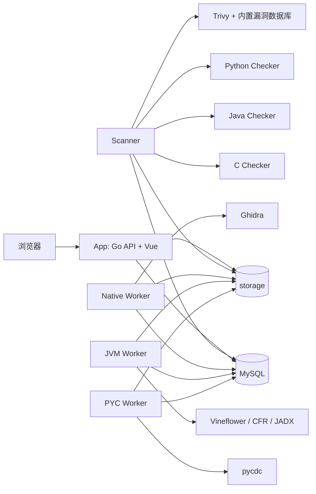

# 项目架构与目录职责

本文基于当前源码、Dockerfile 和 Compose 配置梳理模块边界，说明为什么保留 `app`、`checkers` 与 `deploy`，以及 `script`、`local`、`release` 的职责。真实构建和目标机器部署验收仍须按构建指南执行；代码结构分析不代表已通过物理断网运行验收。

## 1. 目录设计

```text
binary/
├─ app/                         产品主系统源码
│  ├─ backend/                  一个 Go module，五个进程入口
│  │  ├─ cmd/                   app / scanner / 三类 decompiler
│  │  ├─ internal/              API、调度、工具适配、存储等内部实现
│  │  ├─ api/                   产品 HTTP API 和 checker-v1 协议
│  │  ├─ migrations/            编译进服务的数据库迁移
│  │  └─ tools/ghidra/          与反编译实现绑定的 Ghidra 导出脚本
│  ├─ frontend/                 Vue 应用及其构建配置
│  └─ Dockerfile                前端编译后嵌入 Go 的 App 镜像
├─ checkers/                    C / Java / Python 无状态源码分析服务
├─ deploy/                      镜像与部署的声明式资源
│  ├─ docker/                   Worker Dockerfile、开发 Compose、镜像锁定配置
│  ├─ tools/                    工具基础镜像 Dockerfile
│  └─ delivery/                 交付包运行脚本和配置模板
├─ script/                      开发人员在仓库中执行的操作入口
│  ├─ build-local/              构建根目录 local 的入口
│  ├─ build-release/            构建根目录 release 的入口
│  ├─ lib/                      两种打包流程共用实现
│  ├─ tools/                    工具镜像及漏洞数据库制备
│  ├─ ops/                      源码仓库运维和数据操作
│  ├─ tests/                    验证与回归脚本
│  ├─ fixtures/                 测试样本生成
│  └─ legacy/                   保留的旧双交付工作流
├─ docs/                        架构与构建说明
├─ docker-compose.yml           九服务的唯一基础编排定义
├─ local/                       生成物：本机已构建镜像的运行目录
└─ release/                     生成物：镜像归档和离线部署目录
```

`app` 和 `checkers` 的现有边界符合实际依赖关系，打包工作不需要重新划分 Go module，也不需要把五个 Go 入口分成五个顶层项目。迁移核心源码会同时影响导入路径、构建上下文、嵌入资源和测试，不能给本次交付需求带来相应收益。

`deploy` 不能直接删除。它包含 scanner、三类反编译 Worker 的 Dockerfile，Ghidra、JVM 工具、pycdc、Trivy 离线数据库的镜像定义，以及客户部署所需模板。新的职责划分是：`script` 放操作入口，`deploy` 放这些入口消费的构建与交付资源。交付包内的管理脚本在仓库中作为模板保留，是因为它们执行时面对客户的交付目录，而不是源码仓库。

`local` 和 `release` 不属于源码，不能参与镜像构建上下文或 Git 提交。二者内部的运行数据也不能被下一次打包静默覆盖。根目录 Compose 继续作为公共定义，避免维护两份逐渐分叉的服务清单。

## 2. 核心源码职责

### app/backend

后端是 `binaryscan.local/backend` 单一 Go module。五个 `cmd` 入口共享协议、配置和任务模型，独立编译成可执行文件，分别进入各自镜像。

| 目录 | 职责与依赖 |
| --- | --- |
| `cmd/app` | 加载配置，连接 MySQL，执行迁移，引导初始管理员，启动 HTTP API 和静态页面 |
| `cmd/scanner` | 运行格式识别、归档导入、镜像漏洞扫描、三类源码检查的任务执行器 |
| `cmd/native-decompiler` | 运行 Ghidra 原生二进制反编译执行器 |
| `cmd/jvm-decompiler` | 运行 Vineflower、CFR、JADX 反编译执行器 |
| `cmd/pyc-decompiler` | 运行 pycdc 反编译执行器 |
| `internal/app` | 登录、权限、用户与审计、上传、任务、源码访问、报告及归档 API |
| `internal/job` | MySQL 中的任务、尝试、租约、并发资源池和结果发布状态 |
| `internal/worker` | 所有后台进程共用的领取任务、心跳续租、重试和过期租约恢复逻辑 |
| `internal/scanner` | 格式识别流程、Trivy 调用和 checker-v1 HTTP 编排 |
| `internal/decompiler` | 各类反编译命令、限时执行、输出收集及项目发布 |
| `internal/storage` | Blob、路径校验、暂存目录、源码项目清单和发布 |
| `internal/extract`、`filetype`、`containerarchive` | 归档展开、文件类型识别和容器镜像归档检查 |
| `internal/database`、`config` | 数据库连接与迁移、角色运行参数 |
| `internal/webui` | 使用 Go embed 嵌入构建后的前端文件 |

迁移和 Ghidra 脚本是业务服务的编译或运行依赖，应继续紧邻后端源码。不能把它们仅因文件扩展名为 SQL 或 Java 就搬进通用 `script`。

### app/frontend

前端使用 Vue 3、TypeScript、Vite、Pinia、Vue Router、Element Plus 和 Monaco。`views` 组织路由页面，`components` 按上传、任务结果、系统维护等业务区域拆分，`composables` 承载页面状态与操作，`api` 负责 HTTP 适配和响应契约校验。

开发阶段由 Vite 提供页面；生产构建先编译静态资源，再复制进后端的 `internal/webui/dist` 并编译 App。生产环境无需单独运行 Node、Vite 或 Nginx 容器。前端中的 demo 数据属于开发演示能力，不能作为真实服务验收依据。

### checkers

| 服务 | 实现 | 分析输入 |
| --- | --- | --- |
| `c-checker` | Java 21、Spring Boot、ANTLR | Ghidra 输出的伪 C 源码 |
| `java-checker` | Java 21、Spring Boot、JavaParser | JVM/Android 反编译后的 Java 源码 |
| `python-checker` | Python 标准库 HTTP 服务和 `ast` | PYC 反编译后的 Python 源码 |

三个检查器通过统一 `checker-v1` 接收源码文本，返回结构化 finding。它们不访问 MySQL、不挂载业务目录、不接收原始二进制路径；任务状态、失败重试和报告持久化均由主系统负责。Python 检查器当前没有第三方运行依赖，交付时不需要额外准备 pip 包仓库。

## 3. 服务调用关系



图中的 Trivy、Ghidra、JVM 工具和 pycdc 是对应 Worker 镜像内部的进程，不是额外 Compose 服务。最终服务数为九个：MySQL、App、Scanner、三个反编译 Worker 和三个 Checker。

浏览器只连接 App。App 在数据库中创建任务；Worker 从同一数据库领取对应任务类型，通过租约、心跳和 fencing token 管理竞争及恢复。因此这里没有必须一起打包的 Redis、RabbitMQ 或独立任务队列服务。Scanner 向 Checker 发送 HTTP 请求，其他长任务主要经 MySQL 协作。

Compose 中只有 App 发布宿主机端口。数据库网络和 Checker 网络为内部网络，Checker 只加入 Checker 网络。MySQL 健康后启动 App，App 完成初始化并健康后再启动 Worker。Checker 暂不可用时，源码检查流程具备有界重试机制。

## 4. 文件与数据库的持久化边界

| 数据路径 | 内容 | 生命周期 |
| --- | --- | --- |
| `data/mysql` | 用户、任务、运行状态、报告索引、审计等数据库内容 | 持久化，升级和重打包不得删除 |
| `data/storage/uploads` | 上传分片和上传会话文件 | 业务存储的一部分 |
| `data/storage/blobs` | 原始二进制和归档解出的对象 | 持久化 |
| `data/storage/projects/native` | 原生反编译源码项目 | 持久化 |
| `data/storage/projects/jvm` | JVM/Android 反编译源码项目 | 持久化 |
| `data/storage/projects/pyc` | Python 反编译源码项目 | 持久化 |
| `data/storage/artifacts` | finding、工具报告等运行制品 | 持久化 |
| `data/storage/reports` | 用户下载的报告 | 持久化 |
| `data/work/*` | 各 Worker 的中间工作目录 | 临时数据；清理应避开正在运行的任务 |

生产容器采用非 root 用户、只读根文件系统和按角色限制的挂载。Scanner 只读项目目录；每个反编译 Worker 只读 Blob，并只写自己负责的项目子目录；Checker 没有业务卷。

因此，“目录里有 compose 文件”还不足以在所有 Linux 主机启动成功：数据子目录必须齐全，并允许容器配置的 UID/GID 访问。客户初始化脚本应完成目录和权限准备。备份需要数据库和 `storage` 的一致状态，不能只复制镜像归档。

## 5. 构建依赖与离线交付边界

| 最终镜像 | 构建所需依赖 | 客户运行时所需 |
| --- | --- | --- |
| App | Node/npm 依赖、Go modules、distroless 基础镜像 | 最终 App 镜像 |
| Scanner | Go modules、Alpine、Trivy 及预置漏洞数据库镜像 | 最终 Scanner 镜像，内含 Trivy 和数据库 |
| Native Worker | Go modules、含 JDK 的 Ghidra 工具镜像、导出脚本 | 最终 Native 镜像 |
| JVM Worker | Go modules、JRE、Vineflower/CFR/JADX 工具镜像 | 最终 JVM 镜像 |
| PYC Worker | Go modules、pycdc 工具镜像 | 最终 PYC 镜像 |
| C/Java Checker | Maven、JDK、Maven 依赖 | 两个最终 JRE 镜像 |
| Python Checker | Python 基础镜像 | 最终 Python Checker 镜像 |
| MySQL | 已选择的平台对应的官方镜像 | MySQL 镜像 |

`local` 的目标是让构建机直接运行已经准备好的九个镜像；`release` 在同样的运行材料外，再保存全部九个最终镜像供客户导入。客户离线部署不需要源码、Go、Node、Maven、编译工具或镜像仓库。镜像归档及其校验信息必须与包内 Compose 和 `.env` 的镜像引用一致。

离线部署与离线重编译是两个不同需求。制作最终镜像时仍可能需要联网下载 Go/npm/Maven 依赖和工具资产；如果需要客户离线修改源码后重新编译，就必须另外封装构建镜像和依赖缓存，不应隐含在普通 `release` 的承诺中。

Trivy 的离线能力依赖镜像里已经包含漏洞数据库。当前运行参数关闭数据库在线更新，并给每次扫描建立可写缓存；只保存 Trivy 可执行文件或只导出 App 镜像都不足以完成离线扫描。数据库的更新时间是发布材料的一部分，离线客户不会自动获得新的漏洞信息。

## 6. 本次重构处理的实际问题

原先的 `deploy/scripts` 混合镜像构建、运行维护、回归、样本生成和双交付打包。旧打包入口默认输出到开发者的 macOS 路径，还同时制作直接部署包和源码验真包，不符合根目录 `local` / `release` 的目标。

现在保留已分离的核心源码和九服务拓扑，把操作入口集中到 `script`，以共享实现生成两类运行目录。客户脚本和 Compose 均只消费交付目录内的配置及镜像，不再依赖源码仓库的位置。

目录移动应同步检查 Dockerfile 的构建上下文、脚本求仓库根目录的层级、fixture 脚本互相调用的路径和文档链接。Docker 镜像的版本标签也不能代替离线包校验；发布时应记录镜像 ID、平台和归档 SHA-256。

本次不调整 API 协议、数据库结构或分析算法。若后续继续优化核心代码，优先依据具体变更压力拆分 `internal/app` 的业务服务，以及前端 API 契约与适配层；无需为目录整齐而迁移已经独立的 Worker 入口和 Checker 项目。

## 7. 系统维护探测与日志边界

系统维护页保留运行状态、分析器与离线库、模型设置、审计日志。“用户与角色”通过左侧系统管理导航进入独立的 `/users` 页面，仅管理员可访问。存储路径由部署配置和容器挂载控制，网页不提供路径修改。

分析器状态由各 Worker 在本地探测后写入 `worker_capabilities`，管理员通过 `GET /api/v1/admin/system` 查询。默认每 60 秒探测、每 15 秒心跳；探测或心跳超过 180 秒时显示未知。可使用 `BINARY_CAPABILITY_PROBE_SECONDS`、`BINARY_CAPABILITY_REPORT_TTL_SECONDS` 调整。Trivy 双库检查文件非空、元数据及 Schema，离线数据过旧阈值默认 30 天，由 `BINARY_TRIVY_DB_STALE_DAYS` 控制。探测通过表示工具启动、版本或健康端点检查通过，不代表已完成真实样本的全流程验收，也不等于数据库内容完整性验证。

日志分为以下几类，不能互相替代：

| 类型 | 内容与保存位置 | 保留边界 |
| --- | --- | --- |
| 操作审计 | 数据库 `audit_logs`，记录认证、管理变更、任务操作、下载、导出及关键拒绝和失败 | 未配置自动清理；任务删除后保留。补充的请求审计采用有界尽力写入，数据库故障时可能缺失，并产生运行错误日志 |
| HTTP 请求日志 | 容器标准输出中的请求标识、路由模板、方法、状态、耗时等 | 不记录查询参数、请求头、Cookie、密码、令牌或正文；成功健康探针不逐次记录 |
| 任务执行事件 | 数据库 `task_events`，任务详情通过 SSE 读取 | 记录处理阶段与结果；删除任务会级联清理 |
| Worker 运行日志 | 容器标准输出中的调度、租约、完成和错误信息 | Docker `json-file` 按 20 MB × 5 文件轮转，不保证永久保存 |

管理员可在审计页按操作、结果、操作者和时间筛选，CSV 导出覆盖全部匹配快照而非当前分页。单次导出上限为 100,000 条或 32 MiB，超限明确拒绝并要求缩小范围；CSV 中时间使用 UTC。运行日志通过交付包管理脚本的 `logs` 命令或 `docker compose logs` 收集。系统尚未统一收集宿主机 OS 日志、完整外部工具输出或永久保存全部日志，历史缺失记录不能追溯补齐。

此功能新增 `000012_worker_capabilities.sql` 迁移。更新时需重新构建并重启 App 和四个 Worker，App 启动应用迁移；Checker 无需因本次探测机制重建。

## 8. 源码检测规则选择

C/C++ 伪源码、Java、Python 检测启动前，通过 `GET /api/v1/tasks/:taskID/projects/:projectID/check-rules` 读取 Scanner 最近探测到的真实规则目录。界面默认全选，支持按中文名称、规则 ID 和 CWE 筛选与勾选；目录缺失、过期或 Scanner 之间目录冲突时禁止启动。当前目录分别包含 15、20、5 条规则，规则名称、说明和适用限制均由对应 Checker 提供。

启动请求携带 `ruleIds` 和 `catalogVersion`，App 将规则集合与版本冻结到本次运行，幂等重试必须保持同一集合。Scanner 在提交源码前重新核对 Checker 目录版本，Checker 只执行启用规则，并返回实际应用的规则集合供 Scanner 核验。兼容不带选择参数的旧调用时，也会冻结当时目录的全部规则。

JVM 反编译源码项目最多发布 20,000 个源码文件，合计最多 512 MiB，单文件最多 4 MiB。源码列表与 Scanner 使用相同的项目文件数上限。

Java 源码使用每次独立配置的 Java 21 解析器。Scanner 通过 `java-project-v1` 创建绑定项目、运行、源码清单摘要及规则版本的私有上下文，按每批 200 文件上传，清单核验完整后统一分析；批次不再切断调用关系。单项目源码最多 64 MiB，最多两个上下文、合计 128 MiB，15 分钟过期，正常结束、取消或失败后释放。超过项目输入限额时只运行原有有界单文件检查，并明确标为部分完成。其他语言继续使用 `checker-v1`。

空指针分析保存项目内类型、方法签名及有界摘要，逐文件解析并迭代参数和返回值的空值状态；最多 20,000 个方法、100,000 条调用边、16 轮迭代和三分钟分析时间。循环、异常分支、switch 和 Lambda 主体参与分析。已确认类型的 MyBatis/MyBatis-Plus 单对象查询、Map.get 等有可空返回模型，常见非空校验提供正常返回后的保护事实。发现区分明确空值与条件性可空，保留最多 12 步空值来源、调用传递及解引用证据。动态代理、无法解析的调用、复杂对象别名和路径关联仍有能力边界；未知调用单独计数，达到执行预算时返回真实诊断与已完成结果。

框架模型自动读取经大小和 SHA-256 校验的原包 Maven 元数据；官方缺少 Maven 元数据的依赖仅按严格 Manifest 身份和代表类识别，不按文件名猜版本。`framework-evidence-v1` 保存精确坐标、版本、包路径及摘要；冲突坐标停用非空假设并记录诊断。源码会话同时绑定原包摘要和排序后依赖 JSON 的摘要，重试不得修改。当前 `framework-contracts-v1` 包覆盖 Spring 6.1.8、MyBatis 3.5.16、MyBatis-Plus 3.5.6、Hutool 5.8.27、MapStruct Plus 1.3.6 的明确契约；未识别版本保持保守。无需新增配置页面或分级视图。

`java-nullness-v4` 按参数类型、泛型和继承关系筛选可行重载，每方法最多保留八种参数空值摘要，避免不同调用场景相互污染。框架空值谓词、未改写布尔条件和有界本地容器事实可证明部分解引用安全；数据库单条结果、Map 值、缓存值及无实际约束的业务参数仍可空。源码 `modelSummary` 记录版本、模型摘要及有界证明事件，达到证明记录限额单独标记，不用风险等级或业务包白名单删除告警。

Java 新建检测仅运行源码引擎，不再编排 SpotBugs，Java Checker 镜像也不再安装其发行包。原始 JAR 仍用于提取依赖版本以验证源码框架契约，不进行第三方字节码漏洞检测。历史双引擎发现、字节码坐标、合并证据和报告保持可读；旧字节码 API 默认不注册。

`java-nullness-v4` 为参数空值上下文采用独立的返回摘要，避免其他调用上下文的空值污染。JDK 值类型与容器类型的 `equals(null)` 遵守空值相等语义，项目自定义实现仍保守分析。未知返回值不作为空指针证据；数据库单条结果、Map.get 和显式空值路径继续检出。

反编译和源码检测通过有运行 ID 与 fence 校验的任务事件持续报告阶段、已完成数量与总量；长阶段每 15 秒报告活跃状态。Java 项目会话提供非阻塞 `/progress`，Scanner 每 2 秒获取解析、建模和方法分析进度。前端使用阶段权重与真实计数显示总体百分比，不可计量阶段明确标识阶段估算，不按时间伪增。Boot JAR 的准备阶段按主模块及全部内嵌依赖逐个计数；首模块显式保留零起点，防止首个模块完成后被误算成整体完成。

运行进度和诊断写入使用 READ COMMITTED 与 NOWAIT 校验，遇到结果发布持锁立即跳过，避免阻塞发布事务。续租同样避免等待发布锁，并核对运行、owner 和 fencing token；发布事务始终持有独占 fence，提交前恢复完整租期，使大型项目的源码登记不会因旧租期耗尽而被重复执行。

任务信息可导出项目全部信息 ZIP，包括不分页的任务、运行、原始事件、发现、源码文件与符号元数据，以及所有仍可读取的原始输入、检查制品、工具日志、源码项目（含 project.json）和报告。结果页不展示工具诊断和覆盖警告；真实运行状态、原始诊断及截断标识保留在导出数据。完整导出独立使用 15 分钟写入与构建预算，避免大包被普通接口的 60 秒超时截断。导出清单注明缺失、已清理或校验失败的文件；运行中的导出只包含导出时已持久化的信息。

历史检测与 JSON、HTML、DOCX 报告记录启用规则数、目录总数、规则 ID 和目录版本。只选部分规则时，其余规则明确标为本次未检测；旧历史没有规则快照时显示覆盖范围未记录。此链路沿用现有运行请求与 Worker 探测数据，无需额外数据库迁移；启用前需更新 App、Scanner、前端和三个 Checker。

## 9. 分析能力显示名称与原始诊断

系统维护、任务日志、操作入口和源码结果通过统一展示映射使用“漏洞检测引擎”“原生二进制反编译引擎”“Java 反编译引擎”“Android 反编译引擎”“Python 字节码反编译引擎”等业务名称。页面不将第三方组件标注为自研。就绪检查与真实任务执行结果分别展示；过期、未知、不可用和部分完成状态继续保留。

系统维护的“技术诊断”默认折叠，保留实际组件标识、探测版本、配置版本、容器路径及原始检查说明。内部工具标识、SSE 事件类型、Worker 报告、数据库记录和 JSON 报告快照保持原值，展示映射不修改源码、检测证据或漏洞标识。

新生成的 HTML、DOCX 报告采用业务名称展示运行类型和分析引擎，实际组件版本保留在 JSON 快照中。已经生成的报告仍是不可变制品，不回写历史文件；历史任务事件由前端映射使用新的显示名称。此变更仅需更新 App 与前端，无需数据库迁移或重新执行检测。


## 10. Java 源码上下文与安全行为分析（v5）

准备阶段在规范化写入时计算并复用类摘要，避免为重复类核验再次解压全部依赖。JVM 反编译将必要依赖传给 Vineflower library 上下文，并从原包提取描述符、继承关系、泛型 Signature、可保留的声明注解、类摘要和模块身份。私有 `.binaryscan/java-types.json` 与原始输入及源码清单绑定，独立校验大小和 SHA-256，不计入源码文件数，不执行依赖代码。冲突类摘要保留歧义，相同类摘要可合并。依赖元数据不能替代方法体，也不恢复 SpotBugs 字节码检测。

应用模块中的受限 YAML、properties、Mapper XML 等资源通过 `resources/` 随项目发布并按源码文件校验；依赖包的默认资源不作为应用配置。YAML 使用安全节点解析，XML 禁止实体和外部 DTD；跨资源 SQL include 关联原始片段位置。资源或类型索引缺失、解析失败、限额与历史项目缺少上下文均保留真实诊断并进入完整项目导出。

`java-nullness-v5` 保留泛型实参、Class 字面量及已知构造类型身份。MapStruct Plus 1.3.6 的条件非空结论需要匹配目标类型、生成 mapper 的实际返回路径及可证明的分派范围；返回空、自定义工厂、未确认目标 Class 和缺失方法体均保留可空结果。校验入口与内部直接调用独立分析，显式 Validator 成功分支按约束分组及可见级联处理，复杂分组转换/序列、自定义 getter 和缺失 provider 语义继续保守。登录态不证明 session 中用户键存在；只为同一请求存储对象/键且无未知调用干扰的非空写后读建立关系。容器支持局部所有权、同键别名、写后读与可证明非空的 computeIfAbsent；共享缓存、过期与跨线程关系不作无条件非空假设。

普通方法按输入空值状态建立基础 8 个上下文，忽略原始类型参数不可能为空的差异；已出现可空摘要的饱和方法可从项目总计 256 个定向上下文中追加，单方法最多 32，泛型上下文最多 64。达到上限保留诊断，不以 UNKNOWN 替换已知可空来降低告警数。稳定摘要按被调用上下文的版本建立依赖缓存；依赖版本变化时重新分析，仅当整个文件的分析上下文稳定且不含需要重算的初始化调用时跳过预分析解析；安全行为摘要同样按依赖版本失效。最终输出阶段仍完整执行以生成发现与证明。缓存依赖最多 100000 条，超出时停用对应缓存而非丢弃分析。模型摘要记录总上下文数、定向追加数量、缓存命中、摘要依赖边、类型定义数、歧义类型数及有界非空证明。

`java-security-flow-v1` 在项目内执行有界来源、方法摘要、参数副作用及执行点关联，最多 10 轮摘要。SQL 覆盖 MyBatis-Plus 原始 Wrapper 片段与实际执行、Mapper XML/注解原始替换及别名，区分绑定参数、数值限制和受限标识符。表达式区分文本来源与上下文变量；Hutool 包装规则固定到已匹配版本，摘要校验/去重不直接证明安全漏洞，bare AES 的有效模式仍需核对 provider。

新增六条目录规则：Jackson/Redis 宽泛多态配置、JWT 固定签名配置，以及请求输入控制危险执行、不可信字节动态定义类、可疑 Web 组件注册、隐藏认证成功分支（B1–B4）。注册 API 单独出现不报警；正常 Undertow WebSocket 属性配置有反例测试。结果保留来源/执行位置和关联源码跳转，配置密钥值及结果摘要脱敏。规则输出是可复核的配置风险或可疑能力，不能据此确认恶意后门、生产配置生效或可利用 RCE。JSP 资源可保留导出，当前不承诺完整 JSP、字节码混淆或包外运行时注入分析。

原始输入 SHA-256 的十六进制大小写按同一摘要比较，传输会话继续使用规范小写格式。隐式 lambda 在返回值/变量目标函数接口唯一时补入参数类型；已匹配的 Hutool Convert.toStr 保留数值约束，字符串路径继续参与 SQL 风险检测。意外引擎异常保留脱敏的异常类及分析器栈位置并标记部分结果，避免无限重试和泄露配置内容。
