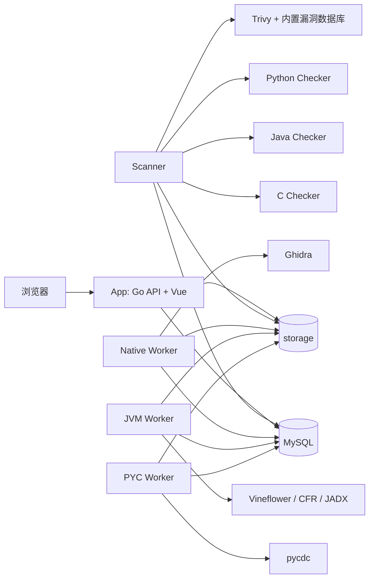

# 项目架构与目录职责

本文基于当前源码、Dockerfile 和 Compose 配置梳理模块边界，说明为什么保留 `app`、`checkers` 与 `deploy`，以及 `script`、`local`、`release` 的职责。真实构建和目标机器部署验收仍须按构建指南执行；代码结构分析不代表已通过物理断网运行验收。

## 1. 目录设计

```text
binary/
├─ app/                         产品主系统源码
│  ├─ backend/                  一个 Go module，五个进程入口
│  │  ├─ cmd/                   app / scanner / 三类 decompiler
│  │  ├─ internal/              API、调度、工具适配、存储等内部实现
│  │  ├─ api/                   产品 HTTP API 和 checker-v1 协议
│  │  ├─ migrations/            编译进服务的数据库迁移
│  │  └─ tools/ghidra/          与反编译实现绑定的 Ghidra 导出脚本
│  ├─ frontend/                 Vue 应用及其构建配置
│  └─ Dockerfile                前端编译后嵌入 Go 的 App 镜像
├─ checkers/                    C / Java / Python 无状态源码分析服务
├─ deploy/                      镜像与部署的声明式资源
│  ├─ docker/                   Worker Dockerfile、开发 Compose、镜像锁定配置
│  ├─ tools/                    工具基础镜像 Dockerfile
│  └─ delivery/                 交付包运行脚本和配置模板
├─ script/                      开发人员在仓库中执行的操作入口
│  ├─ build-local/              构建根目录 local 的入口
│  ├─ build-release/            构建根目录 release 的入口
│  ├─ lib/                      两种打包流程共用实现
│  ├─ tools/                    工具镜像及漏洞数据库制备
│  ├─ ops/                      源码仓库运维和数据操作
│  ├─ tests/                    验证与回归脚本
│  ├─ fixtures/                 测试样本生成
│  └─ legacy/                   保留的旧双交付工作流
├─ docs/                        架构与构建说明
├─ docker-compose.yml           九服务的唯一基础编排定义
├─ local/                       生成物：本机已构建镜像的运行目录
└─ release/                     生成物：镜像归档和离线部署目录
```

`app` 和 `checkers` 的现有边界符合实际依赖关系，打包工作不需要重新划分 Go module，也不需要把五个 Go 入口分成五个顶层项目。迁移核心源码会同时影响导入路径、构建上下文、嵌入资源和测试，不能给本次交付需求带来相应收益。

`deploy` 不能直接删除。它包含 scanner、三类反编译 Worker 的 Dockerfile，Ghidra、JVM 工具、pycdc、Trivy 离线数据库的镜像定义，以及客户部署所需模板。新的职责划分是：`script` 放操作入口，`deploy` 放这些入口消费的构建与交付资源。交付包内的管理脚本在仓库中作为模板保留，是因为它们执行时面对客户的交付目录，而不是源码仓库。

`local` 和 `release` 不属于源码，不能参与镜像构建上下文或 Git 提交。二者内部的运行数据也不能被下一次打包静默覆盖。根目录 Compose 继续作为公共定义，避免维护两份逐渐分叉的服务清单。

## 2. 核心源码职责

### app/backend

后端是 `binaryscan.local/backend` 单一 Go module。五个 `cmd` 入口共享协议、配置和任务模型，独立编译成可执行文件，分别进入各自镜像。

| 目录 | 职责与依赖 |
| --- | --- |
| `cmd/app` | 加载配置，连接 MySQL，执行迁移，引导初始管理员，启动 HTTP API 和静态页面 |
| `cmd/scanner` | 运行格式识别、归档导入、镜像漏洞扫描、三类源码检查的任务执行器 |
| `cmd/native-decompiler` | 运行 Ghidra 原生二进制反编译执行器 |
| `cmd/jvm-decompiler` | 运行 Vineflower、CFR、JADX 反编译执行器 |
| `cmd/pyc-decompiler` | 运行 pycdc 反编译执行器 |
| `internal/app` | 登录、权限、用户与审计、上传、任务、源码访问、报告及归档 API |
| `internal/job` | MySQL 中的任务、尝试、租约、并发资源池和结果发布状态 |
| `internal/worker` | 所有后台进程共用的领取任务、心跳续租、重试和过期租约恢复逻辑 |
| `internal/scanner` | 格式识别流程、Trivy 调用和 checker-v1 HTTP 编排 |
| `internal/decompiler` | 各类反编译命令、限时执行、输出收集及项目发布 |
| `internal/storage` | Blob、路径校验、暂存目录、源码项目清单和发布 |
| `internal/extract`、`filetype`、`containerarchive` | 归档展开、文件类型识别和容器镜像归档检查 |
| `internal/database`、`config` | 数据库连接与迁移、角色运行参数 |
| `internal/webui` | 使用 Go embed 嵌入构建后的前端文件 |

迁移和 Ghidra 脚本是业务服务的编译或运行依赖，应继续紧邻后端源码。不能把它们仅因文件扩展名为 SQL 或 Java 就搬进通用 `script`。

### app/frontend

前端使用 Vue 3、TypeScript、Vite、Pinia、Vue Router、Element Plus 和 Monaco。`views` 组织路由页面，`components` 按上传、任务结果、系统维护等业务区域拆分，`composables` 承载页面状态与操作，`api` 负责 HTTP 适配和响应契约校验。

开发阶段由 Vite 提供页面；生产构建先编译静态资源，再复制进后端的 `internal/webui/dist` 并编译 App。生产环境无需单独运行 Node、Vite 或 Nginx 容器。前端中的 demo 数据属于开发演示能力，不能作为真实服务验收依据。

### checkers

| 服务 | 实现 | 分析输入 |
| --- | --- | --- |
| `c-checker` | Java 21、Spring Boot、ANTLR | Ghidra 输出的伪 C 源码 |
| `java-checker` | Java 21、Spring Boot、JavaParser | JVM/Android 反编译后的 Java 源码 |
| `python-checker` | Python 标准库 HTTP 服务和 `ast` | PYC 反编译后的 Python 源码 |

三个检查器通过统一 `checker-v1` 接收源码文本，返回结构化 finding。它们不访问 MySQL、不挂载业务目录、不接收原始二进制路径；任务状态、失败重试和报告持久化均由主系统负责。Python 检查器当前没有第三方运行依赖，交付时不需要额外准备 pip 包仓库。

## 3. 服务调用关系



图中的 Trivy、Ghidra、JVM 工具和 pycdc 是对应 Worker 镜像内部的进程，不是额外 Compose 服务。最终服务数为九个：MySQL、App、Scanner、三个反编译 Worker 和三个 Checker。

浏览器只连接 App。App 在数据库中创建任务；Worker 从同一数据库领取对应任务类型，通过租约、心跳和 fencing token 管理竞争及恢复。因此这里没有必须一起打包的 Redis、RabbitMQ 或独立任务队列服务。Scanner 向 Checker 发送 HTTP 请求，其他长任务主要经 MySQL 协作。

Compose 中只有 App 发布宿主机端口。数据库网络和 Checker 网络为内部网络，Checker 只加入 Checker 网络。MySQL 健康后启动 App，App 完成初始化并健康后再启动 Worker。Checker 暂不可用时，源码检查流程具备有界重试机制。

## 4. 文件与数据库的持久化边界

| 数据路径 | 内容 | 生命周期 |
| --- | --- | --- |
| `data/mysql` | 用户、任务、运行状态、报告索引、审计等数据库内容 | 持久化，升级和重打包不得删除 |
| `data/storage/uploads` | 上传分片和上传会话文件 | 业务存储的一部分 |
| `data/storage/blobs` | 原始二进制和归档解出的对象 | 持久化 |
| `data/storage/projects/native` | 原生反编译源码项目 | 持久化 |
| `data/storage/projects/jvm` | JVM/Android 反编译源码项目 | 持久化 |
| `data/storage/projects/pyc` | Python 反编译源码项目 | 持久化 |
| `data/storage/artifacts` | finding、工具报告等运行制品 | 持久化 |
| `data/storage/reports` | 用户下载的报告 | 持久化 |
| `data/work/*` | 各 Worker 的中间工作目录 | 临时数据；清理应避开正在运行的任务 |

生产容器采用非 root 用户、只读根文件系统和按角色限制的挂载。Scanner 只读项目目录；每个反编译 Worker 只读 Blob，并只写自己负责的项目子目录；Checker 没有业务卷。

因此，“目录里有 compose 文件”还不足以在所有 Linux 主机启动成功：数据子目录必须齐全，并允许容器配置的 UID/GID 访问。客户初始化脚本应完成目录和权限准备。备份需要数据库和 `storage` 的一致状态，不能只复制镜像归档。

## 5. 构建依赖与离线交付边界

| 最终镜像 | 构建所需依赖 | 客户运行时所需 |
| --- | --- | --- |
| App | Node/npm 依赖、Go modules、distroless 基础镜像 | 最终 App 镜像 |
| Scanner | Go modules、Alpine、Trivy 及预置漏洞数据库镜像 | 最终 Scanner 镜像，内含 Trivy 和数据库 |
| Native Worker | Go modules、含 JDK 的 Ghidra 工具镜像、导出脚本 | 最终 Native 镜像 |
| JVM Worker | Go modules、JRE、Vineflower/CFR/JADX 工具镜像 | 最终 JVM 镜像 |
| PYC Worker | Go modules、pycdc 工具镜像 | 最终 PYC 镜像 |
| C/Java Checker | Maven、JDK、Maven 依赖 | 两个最终 JRE 镜像 |
| Python Checker | Python 基础镜像 | 最终 Python Checker 镜像 |
| MySQL | 已选择的平台对应的官方镜像 | MySQL 镜像 |

`local` 的目标是让构建机直接运行已经准备好的九个镜像；`release` 在同样的运行材料外，再保存全部九个最终镜像供客户导入。客户离线部署不需要源码、Go、Node、Maven、编译工具或镜像仓库。镜像归档及其校验信息必须与包内 Compose 和 `.env` 的镜像引用一致。

离线部署与离线重编译是两个不同需求。制作最终镜像时仍可能需要联网下载 Go/npm/Maven 依赖和工具资产；如果需要客户离线修改源码后重新编译，就必须另外封装构建镜像和依赖缓存，不应隐含在普通 `release` 的承诺中。

Trivy 的离线能力依赖镜像里已经包含漏洞数据库。当前运行参数关闭数据库在线更新，并给每次扫描建立可写缓存；只保存 Trivy 可执行文件或只导出 App 镜像都不足以完成离线扫描。数据库的更新时间是发布材料的一部分，离线客户不会自动获得新的漏洞信息。

## 6. 本次重构处理的实际问题

原先的 `deploy/scripts` 混合镜像构建、运行维护、回归、样本生成和双交付打包。旧打包入口默认输出到开发者的 macOS 路径，还同时制作直接部署包和源码验真包，不符合根目录 `local` / `release` 的目标。

现在保留已分离的核心源码和九服务拓扑，把操作入口集中到 `script`，以共享实现生成两类运行目录。客户脚本和 Compose 均只消费交付目录内的配置及镜像，不再依赖源码仓库的位置。

目录移动应同步检查 Dockerfile 的构建上下文、脚本求仓库根目录的层级、fixture 脚本互相调用的路径和文档链接。Docker 镜像的版本标签也不能代替离线包校验；发布时应记录镜像 ID、平台和归档 SHA-256。

本次不调整 API 协议、数据库结构或分析算法。若后续继续优化核心代码，优先依据具体变更压力拆分 `internal/app` 的业务服务，以及前端 API 契约与适配层；无需为目录整齐而迁移已经独立的 Worker 入口和 Checker 项目。
