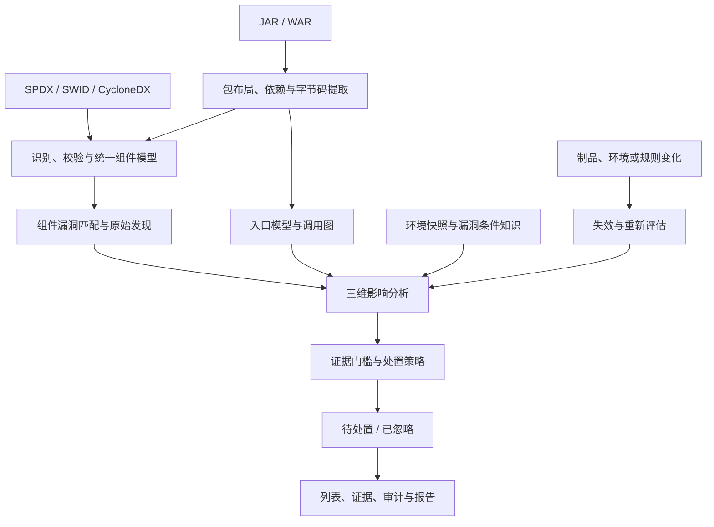

# SBOM 文件扫描与 Java 二进制漏洞可达性需求分析

日期：2026-11-17  
分析对象：BinaryScan 当前仓库，以及客户提供的两条需求。  
文档性质：需求解释、现状差距与改进建议；本文不代表相关功能已经实现或通过运行验收。

## 1. 核心判断

**客户真正想要的是“软件供应链漏洞识别 + 实际影响判断 + 自动化处置闭环”。**

第一条解决输入问题：客户已经有其他工具或供应商提供的软件清单，希望直接导入并检查其中的组件漏洞，不必重新提交源码或安装包。第二条解决结果质量问题：扫描器发现某个版本存在漏洞之后，还需要判断当前 Java 应用和部署环境是否具备触发条件，以减少无效告警和人工排查。

因此，完整业务链路应当是：

> 接收清单或安装包 → 识别组件及版本 → 匹配已知漏洞 → 分析调用与部署条件 → 按策略保留或忽略 → 保存证据并在条件变化时重新评估。

这不是简单增加三个文件后缀，也不是给现有漏洞列表增加一个前端过滤按钮。它要求增加软件成分分析（SCA）能力，并建立漏洞分析结论与处置状态的关联。

当前项目已有文件识别、JVM 反编译、Java 代码检测、任务调度、报告和审计基础，可以复用；但还不能直接据此承诺满足这两条需求。最大的技术缺口是：**Java 组件漏洞识别、CVE 与受影响代码/条件的映射、保守且可解释的可达性判断，以及持久化的自动忽略机制。**

本文将“虚拟分析设置”暂按“用户配置目标运行环境与分析假设”理解，而非真实启动虚拟机。该词在客户描述中未被定义，最终需在需求评审中确认。

## 2. 两条需求分别在解决什么问题

| 原始要求 | 业务目的 | 产品应交付的结果 | 不能据此承诺的能力 |
| --- | --- | --- | --- |
| 扫描 SPDX、SWID、CycloneDX 文件 | 接入供应商清单及其他扫描平台的数据，统一排查组件风险 | 格式识别、校验、组件入库、漏洞匹配、质量提示、结果查询与报告 | 仅凭清单证明方法级不可达，或证明清单完整对应某个实际安装包 |
| 对 JAR/WAR 做漏洞可达性分析 | 区分“带有漏洞组件”和“业务可能调用受影响代码” | 受影响组件/方法定位、入口到漏洞代码的调用证据，或带适用范围的不可达结论 | 只要没有搜索到方法名，就判定不会受影响 |
| 通过虚拟分析设置进行分析 | 在不能连接生产环境时，按配置模拟部署条件 | 可保存、可版本化的环境画像与分析策略 | 未经定义就承诺动态沙箱、完整程序仿真或真实攻击验证 |
| 自动过滤，状态变为已忽略 | 减少反复人工处置，让策略结果进入漏洞管理流程 | 后端持久化“已忽略”，记录原因、证据、范围，支持恢复与重评 | 删除原始漏洞、只在页面隐藏，或把已忽略当成已修复 |
| 可达性、环境兼容性、攻击向量三维分析 | 从代码、部署前提和攻击条件三个层面判断实际影响 | 每个维度独立展示结论、依据和未知原因，再形成综合建议 | 用一个综合分数代替三维证据，或任一维度分数低就自动忽略 |

客户可能还有供应商交付验收、离线安全评估、统一漏洞台账等目的，但这些属于根据需求推测的场景，不能直接作为已确认范围。许可证合规、恶意代码检测、自动升级修复也不应隐含加入本次交付。

### 2.1 必须先统一的术语

1. **“扫描清单”**：解析清单中的软件身份和版本，使用漏洞情报进行匹配。它与扫描清单文件本身是否包含恶意代码是不同能力。
2. **“漏洞可达”**：在指定入口、依赖和运行条件下，存在到达受影响代码的调用可能；存在调用路径仍不等于攻击者一定能控制输入并成功利用。
3. **“环境兼容性”**：建议改称“漏洞环境适用性”，判断漏洞所需 OS、JDK、容器、依赖或配置是否成立。如果客户指的是升级后是否能正常运行，那是另一项兼容性测试需求。
4. **“攻击向量”**：先指 CVSS 定义的网络、相邻网络、本地、物理等攻击途径，再结合目标环境判断其攻击条件。CVSS 原始向量本身不是环境扫描结果。[FIRST CVSS v3.1 规范](https://www.first.org/cvss/v3.1/specification-document)
5. **“已忽略”**：漏洞仍被记录，但在指定分析范围内从待处置列表排除；它不等于漏洞消失、版本已修复或风险永久不存在。

## 3. 当前项目现状与差距

以下结论来自当前工作区的静态代码检查；未在本次分析中运行真实 SBOM 或 JAR/WAR 扫描，也未验证部署镜像。

| 能力 | 源码中已确认的基础 | 与新需求的差距 |
| --- | --- | --- |
| 输入格式 | `internal/filetype/detect.go` 定义 binary、archive、container，包含 JAR/WAR/EAR 识别 | 未见 SBOM 类别和 SPDX/SWID/CycloneDX 内容识别与解析链路；增加后缀白名单不够 |
| 漏洞扫描 | `internal/scanner/executor.go` 中 `loadTrivySubject` 限定 Docker/OCI TAR，`trivyImageArgs` 使用 `trivy image` | 需要增加清单扫描和 Java 安装包组件扫描；现有镜像漏洞扫描不是完整的 JAR/WAR SCA 链路 |
| 漏洞字段 | 当前 Trivy 结构解析 ID、包名、版本、严重性、描述、修复版本等 | 需补齐组件实例身份、匹配依据、CVSS 向量及来源；不能假设现有字段足够支撑三维分析 |
| JVM 包处理 | `internal/jvmarchive/prepare.go` 已有 Spring Boot 包归一化、模块摘要、依赖区分、classpath 顺序及诊断 | Boot 专用路径不覆盖全部普通 JAR/WAR；当前目标 Java release 固定为 21，需按环境配置选择，classpath 回退也不证明实际类加载顺序 |
| Java 检测 | `internal/scanner/java_project.go` 和 `checkers/java` 已有项目级代码分析、依赖上下文及字节码辅助验证 | 主要用于代码缺陷规则，不能直接等价为第三方组件 CVE 的全程序可达性分析 |
| 方法与源码证据 | Java 项目上下文有用于现有分析的内存调用边，前端有方法索引展示结构，源码导航和证据展示可以复用 | 依赖类型索引仅含签名等元数据；现有边未作为通用调用图导出，方法索引 UI 也不能证明生产链路已有完整方法/调用图输出 |
| 局部自动抑制 | `FrameworkBytecodeVerifier.java` 和 `scanner/spotbugs.go` 对特定非空契约保存原始发现、证明、模型版本和哈希绑定 | 值得复用其证据校验模式，但它属于特定代码缺陷的抑制，不是组件 CVE 过滤，也没有完整的业务“已忽略”工作流 |
| 漏洞生命周期 | 基线迁移的 `findings` 有 finding 类型、严重性、规则、外部 ID、位置与详情 | 当前迁移中未见完整的漏洞处置状态、自动忽略原因、环境范围与恢复历史模型 |
| 页面与报告 | `VulnerabilityResultWorkspace.vue` 等已提供漏洞列表、详情、严重性筛选；后端有报告与审计能力 | 需增加三维结论、状态筛选、忽略/恢复操作、分析设置与报告统计口径 |
| 调度与离线交付 | 已有 runs/jobs、Worker 租约与 fencing 发布、Trivy 离线数据库及分析器探测 | 可以复用，但需新增分析任务类型、结果版本和漏洞方法/环境规则的离线更新机制 |

**关键区别：现有 Java 检查以代码缺陷检测为主，新需求重点是第三方组件漏洞的适用性。** 两者可以共享输入、源码和证据展示，不能把 Java 检查器“检测完成”直接当作 CVE 分析完成。

主要源码入口：

- [格式识别](../app/backend/internal/filetype/detect.go)、[扫描调度与 Trivy 调用](../app/backend/internal/scanner/executor.go)。
- [Boot 包分析输入](../app/backend/internal/jvmarchive/prepare.go)、[Java 项目分析编排](../app/backend/internal/scanner/java_project.go)、[Java 检查器](../checkers/java/src/main/java/com/binaryscan/checker/java)。
- [依赖类型上下文](../app/backend/internal/jvmarchive/context.go)、[项目调用解析](../checkers/java/src/main/java/com/binaryscan/checker/java/ProjectContext.java)、[字节码抑制证据校验](../app/backend/internal/scanner/spotbugs.go)。
- [数据库基线](../app/backend/migrations/000001_baseline.sql)、[漏洞结果页面](../app/frontend/src/components/tasks/results/VulnerabilityResultWorkspace.vue)、[报告渲染](../app/backend/internal/app/report_render.go)。
- [现有架构](architecture.md)、[工具镜像版本](../deploy/docker/images.lock.env)。

## 4. 改进一：建立真正的 SBOM 导入与扫描流程

### 4.1 明确“支持格式”的交付矩阵

SPDX 和 CycloneDX 不只是文件扩展名，还包含版本、序列化方式与语义结构。SWID 主要描述具体软件产品的身份和发布信息，不能假定每个 SWID 文件都带有完整依赖图、包坐标和漏洞列表。[SPDX 包信息规范](https://spdx.github.io/spdx-spec/v2.3.1/package-information/)、[NIST SWID 说明](https://csrc.nist.gov/projects/software-identification-swid)

建议以客户验收样本冻结如下基线；**这是建议的支持范围，不是对“所有版本和编码均支持”的承诺。**

| 标准 | 建议首批验收范围 | 必须说明的边界 |
| --- | --- | --- |
| SPDX | 2.3 系列 JSON、Tag/Value；客户存在 2.2 文件时加入对应样本 | 2.3.1 等修订版也要单独验证；RDF/XML、YAML、SPDX 3.x 等需列明是否纳入 |
| CycloneDX | 1.4/1.5/1.6 JSON 与 XML，以实际客户版本确定最终集合 | 1.7、Protobuf 等另列支持状态；不得把 JSON 支持写成所有 CycloneDX 文件支持 |
| SWID | ISO/IEC 19770-2:2015 对应 XML，覆盖客户需要的标签类型 | 保存 tagId、软件名、版本、实体、关联与载荷信息；缺少组件坐标时应明确匹配受限 |

客户原文未限定编码。如果最终只交付 SPDX JSON、CycloneDX JSON，却未说明 XML 和其他编码的边界，会产生验收争议。建议在开发前收集三种格式的真实样本，并把格式、版本、编码、规模和预期结果附入验收清单。

### 4.2 导入过程应交付的能力

1. **内容识别和结构校验**：依据版本字段、根元素、命名空间等识别，不只看 `.json`、`.xml` 或 `.spdx` 后缀；按受支持版本校验，返回可定位的错误。
2. **统一组件模型**：保存名称、版本、生态、供应商、PURL、CPE、哈希、依赖关系、原文标识及数据来源。字段缺失时保留未知状态，不凭文件名补造确定身份。
3. **保留资产实例**：同一组件可出现在多个路径，同名组件可有不同版本；组件身份去重与安装位置去重分开处理，原始关系不能丢失。
4. **漏洞重新匹配**：使用当前指定版本的漏洞库生成扫描结果；导入文件原有的漏洞/VEX 声明单独保存来源与信任状态，不能无条件覆盖本地结论。
5. **质量提示**：展示总组件数、可识别数、版本缺失数、匹配受限数、依赖关系完整性及解析告警。“零漏洞”“未能匹配”“未完成扫描”必须区分。
6. **保留原文与版本**：保存原始文件摘要、文档版本、解析器版本、扫描时间、漏洞库版本，支持复核和库更新后的重扫。
7. **限制输入资源**：XML 禁用外部实体和外部网络解析；对文件大小、嵌套层级、关系数和归档解压设置上限，超限明确标记失败或部分完成。

特别注意：SPDX 规范允许包版本缺省，因此“文件符合标准”并不意味着“其中每个包都足以做准确漏洞匹配”。[SPDX 包版本字段](https://spdx.github.io/spdx-spec/v2.3.1/package-information/#73-package-version-field)

### 4.3 如何复用 Trivy

Trivy 官方文档列有 SBOM 输入扫描，包含 SPDX Tag/Value、SPDX JSON 和 CycloneDX 输入；同时说明 CycloneDX XML 暂不支持，第三方工具生成的 SBOM 也可能影响识别准确性。该文档没有列出 SWID 输入。[Trivy SBOM 输入文档](https://trivy.dev/docs/latest/target/sbom/)

因此可先验证并复用 Trivy 的 JSON/Tag/Value 扫描通道，但仍应由产品层负责格式校验、统一模型、结果质量和实例关联。SWID 与 CycloneDX XML 需要适配器或其他经验证的解析能力；不能仅配置一个 `trivy sbom` 命令就宣称满足全部格式。

仓库锁定的 Trivy 来源镜像为 `0.74.0`。以上是本次查询的官方文档边界，**尚未对该锁定版本做样本验证**；具体支持范围以最终镜像、命令参数及验收样本为准。格式转换也必须检测身份、关系和来源信息是否丢失。

### 4.4 与二进制分析的关联

- 只有清单：完成组件漏洞扫描；方法级可达性应显示“缺少二进制，无法判断”。
- 只有 JAR/WAR：从包中提取组件和字节码，完成能够覆盖的组件匹配与影响分析。
- 同时提供清单和包：通过摘要、坐标、版本、路径及构建信息验证关联；无法验证的一部分保留冲突或未知，不能因为产品名相同就合并。

## 5. 改进二：补齐 JAR/WAR 组件漏洞与可达性分析

### 5.1 先识别漏洞，再讨论可达性

JAR/WAR 分析至少需要两层结果：

- **组件层**：例如包内确实存在某依赖及其版本，命中了哪个 CVE，匹配依据是什么。
- **代码与条件层**：这个 CVE 对应哪些受影响方法、类、资源、配置或协议行为，这些部分是否会在当前应用中触发。

关键依赖是一套可维护的“组件版本 → 漏洞 → 受影响代码/触发条件”知识。普通漏洞库可能只有组件版本范围，没有可靠的方法映射。**缺少方法映射时必须保留组件漏洞并显示“可达性未知”，不能把没有映射理解为没有漏洞代码。**

有些漏洞涉及配置、资源文件、框架生命周期或原生代码，不能强行转换成一个 Java 方法。应允许条件型规则、类/资源级证据，以及“该类型暂不支持方法级分析”。

### 5.2 推荐的分析流程

1. **还原包结构**：覆盖普通 JAR、Spring Boot JAR、WAR 的应用类与依赖目录；记录 `BOOT-INF`、`WEB-INF` 中的实例路径和哈希。外部容器提供的依赖必须允许补充。
2. **确定有效运行上下文**：收集依赖、重复类、classpath 优先级、目标 JDK、多版本 JAR 的有效字节码；缺失或冲突形成诊断。
3. **建立组件身份与漏洞命中**：综合 `pom.properties`、`pom.xml`、Manifest、类指纹等证据；对 shaded/重定位、改包、版本缺失等情况保留不确定性。
4. **确定入口**：覆盖 `main`、Servlet/Filter/Listener、Spring HTTP 入口、初始化、任务调度、消息消费等约定范围；允许补充入口与反射模型。WAR 不应因缺少 `main` 被判为不可达。
5. **构建跨方法调用图**：处理继承、接口、多态、Lambda 等；框架回调、反射、SPI、动态类加载、JNI 等未覆盖部分形成明确缺口。
6. **匹配漏洞目标与路径**：从入口搜索到受影响方法/类的可能调用路径；需要时补充参数或污点证据，但区分“代码可达”和“攻击输入可达”。
7. **输出覆盖信息**：给出已分析模块、入口模型、缺失依赖、未解析目标、超时/截断、漏洞映射覆盖和结论适用范围。

字节码应作为主要分析依据，反编译源码用于解释、定位和辅助规则。反编译失败不应自动导致漏洞被忽略；如果字节码仍可分析，可以继续提供有限结论。

现有 Java 分析组件可以作为接入起点，但完整调用图算法应先做样本验证。可将 SootUp 等作为候选，而不是未经验证就指定为最终依赖；其官方文档也强调入口、调用图算法以及反射/动态调用模型对结果的影响。[SootUp 调用图文档](https://soot-oss.github.io/SootUp/latest/callgraphs/)

### 5.3 三类可达性结论

| 结论 | 含义 | 对处置的影响 |
| --- | --- | --- |
| 可达 / 存在可能路径 | 在当前模型中找到入口至受影响代码的路径 | 保留原始发现并展示路径；其他维度没有有效排除证据时保留待处置，不直接宣称已证实可利用 |
| 在已声明模型与范围内不可达 | 漏洞映射、入口、依赖和调用模型满足该规则的证据要求，且无到达目标的路径 | 可进入自动忽略策略，必须带范围、前提和失效条件 |
| 未知 / 不支持 | 缺二进制、方法映射、依赖或框架模型，存在相关动态调用缺口，或分析失败/超限 | 保留待分析，显示具体原因，禁止按不可达自动忽略 |

静态分析很难对任意 Java 程序证明绝对不可达。因此不能只给一个主观“置信度 95%”作为自动忽略依据，应使用可审查的证据门槛与明确的支持边界。相关缺口能否影响当前 CVE 的结论也要逐项判断；不应把整包一个粗略覆盖率当作所有漏洞的证明。

## 6. 改进三：把“虚拟分析设置”做成环境画像

建议页面名称为“虚拟分析设置 / 目标环境”，向用户解释：本次分析基于所选环境与假设；保存配置本身不代表系统已验证生产环境。

| 配置组 | 建议内容 | 主要用途 |
| --- | --- | --- |
| 运行平台 | OS、架构、JDK 发行版与版本、Servlet 容器及版本 | 判断已知漏洞的环境前提，选择有效字节码与运行库 |
| 应用类型与入口 | 普通 Java、Spring Boot、WAR；Web、定时任务、消息入口；自定义入口 | 减少入口漏建造成的错误不可达 |
| 依赖上下文 | 外部依赖、容器共享库、classpath、目标模块 | 补齐包外依赖和类加载条件 |
| 功能与配置 | 漏洞相关功能开关、协议、序列化配置、启用的框架模块 | 判断具体漏洞触发前提；未知值必须显式保留 |
| 攻击条件 | 公网/内网/相邻网络、访问路径、认证/权限、用户交互、出入站限制 | 判断攻击条件是否成立，辅助优先级和策略 |
| 分析与处置策略 | 三维分析开关、建议模式/自动忽略、规则版本、有效期 | 控制分析与状态变更，留存每次使用的配置快照 |
| 数据来源 | 人工声明、配置文件提取、运行环境采集；采集/确认时间 | 区分假设与事实，判断证据可信度与是否过期 |

配置应支持“未知”，避免用默认 Linux、默认 JDK 或默认无公网暴露替代缺失信息。每个配置版本绑定分析结果，并允许同一制品关联测试、生产等多个环境。

### 6.1 环境适用性维度

将漏洞规则中明确的必要环境条件与环境画像逐项比较，输出“适用、必要条件不满足、未知”。例如，一个**明确仅影响某平台分支**的漏洞，在已核实使用另一平台且不存在相关分支的目标中，可以给出环境不适用依据。

不能用“JDK 较新”“部署在 Linux”“系统能正常启动”来泛化过滤第三方 Java 库漏洞。若客户要求的是升级兼容性，需要另外增加升级候选版本、API/二进制兼容性及回归测试范围。

### 6.2 攻击向量维度

保留原始 CVSS 版本、向量、评分及来源，再给出目标环境下攻击条件“满足、不满足、未知”的分析；不要静默修改官方基础评分。对 v3.1、v4.0 等不同版本应使用对应解析模型，不能混用字段。

特别是，`AV:N` 不代表只能从公网攻击。FIRST 明确指出，同一内网中的远程攻击也可能属于 Network。因此“没有公网入口”“部署在内网”都不足以直接忽略网络型漏洞。[FIRST 对攻击向量的说明](https://www.first.org/cvss/v3.1/specification-document)

入站受限也不能排除通过消息、文件导入、出站访问、本地权限或供应链触发的路径。一般网络边界声明适合用于排序；只有针对特定漏洞的必要条件确实被排除，并且没有未覆盖的替代路径时，才可进入自动忽略判断。

## 7. 改进四：建立自动忽略与恢复的状态闭环

### 7.1 分开保存“发现、分析、处置”

| 层次 | 建议保存内容 | 示例 |
| --- | --- | --- |
| 原始发现 | 制品、组件实例、漏洞 ID、影响版本、匹配证据、扫描库版本 | 某路径的某版本组件命中 CVE |
| 分析结论 | 三维结论、证据、未知原因、分析器/规则版本、环境快照 | 可达性未知；环境适用；攻击条件待确认 |
| 处置状态 | 待处置、已忽略、已修复等；来源、原因、操作者、有效期与历史 | 已忽略，来源为自动策略，适用生产环境 A |

三维分析状态不要直接复用任务运行状态。一次分析可以正常完成但结论为未知，也可能部分完成；“任务成功”不是“漏洞无影响”。

默认列表可以排除已忽略项，但必须能查看“全部”“已忽略”和忽略历史。报告应同时给出原始命中数、待处置数、自动忽略数、人工忽略数与未知数，并说明统计单位是组件实例还是去重漏洞；未知是分析属性，可与待处置重叠，三维原因也可能重叠，不能把这些数字直接相加。报告须固定生成时的环境、分析和处置快照；后续恢复操作不应改写已生成的历史报告。

### 7.2 自动忽略的判定规则

建议采用以下业务规则，而不是“任意维度低风险就忽略”：

```text
允许自动忽略 =
    已启用对应版本的自动处置策略
    且结论绑定当前制品、组件实例和目标环境
    且证据有效、来源满足规则要求
    且至少一个漏洞利用的必要条件被可靠证据排除
    且不存在影响该排除结论的未知、冲突或分析缺口
```

一个必要条件被确证排除，可以使当前场景不受影响，因此不要求三个维度都输出“不满足”；但也不能把一个维度的弱信号或用户猜测当作排除证明。

| 情况 | 建议处理 |
| --- | --- |
| 受影响方法映射可靠，当前范围的入口/依赖/动态调用模型满足证据要求，并证明目标不可达 | 自动策略启用时置为“已忽略”，原因标明代码不可达及范围 |
| 官方或经审校规则明确要求某环境/配置，当前有效证据确认其不存在 | 可以按对应规则忽略，并绑定环境快照和失效条件 |
| 没找到路径，但存在相关反射、漏依赖、未建模入口或分析截断 | 可达性未知，保留待处置 |
| 只有“内网部署”“低分”“无可用利用代码”等信息 | 调整排序或给出建议，不能仅据此自动忽略 |
| 第三方 SBOM 自带“不受影响”或 VEX 声明 | 单独记录声明及来源；通过产品定义的信任与适用范围检查后再参与策略 |
| 用户基于业务判断接受风险 | 允许有权限的人工忽略，记录风险接受理由；不能包装为自动证明不受影响 |
| 新分析与旧忽略结论冲突，或原证据过期/前提改变 | 自动忽略失效，恢复待处置并记录事件 |

示例：某漏洞的方法可达，但其**经核实的唯一必要配置条件**未启用，可以因为配置条件不满足而在该环境忽略；记录中仍应保留“方法可达”。若这个功能开关只是用户未核实的猜测，则不能自动忽略。

### 7.3 状态变更必须可追溯、可撤销

自动变更记录至少包含：发现实例 ID、原状态/新状态、自动或人工来源、原因代码、证据引用、策略版本、分析运行 ID、制品摘要、环境版本、生效时间、有效期和失效条件。

制品/组件变化、环境变化、漏洞影响范围修订、方法映射修正、入口模型或规则更新，均应触发相关结果失效或重评。系统只能对已感知的变化触发自动重评；若环境完全由人工声明，需依靠用户更新和到期提醒，不能承诺持续感知生产变化。

重扫产生新的 run 和 finding 时，应通过稳定的逻辑实例身份关联历史，不能仅凭当前行 ID 或全局 CVE ID 继承忽略。身份至少关联项目/制品版本、组件坐标或指纹、实例路径、漏洞别名与目标环境；变化后重新验证继承条件。

同一制品用于多个环境时，忽略必须按环境保存。汇总页只要仍有任一有效环境受影响或未知，就不能将整个漏洞标为全局已忽略。同一 CVE 对应多个组件实例时也需逐实例判断。

建议人工恢复操作同时生成指定范围和有效期内的“保留待处置”覆盖，在覆盖有效期间优先于自动忽略策略，避免恢复后立即被同一规则再次忽略。覆盖到期或被有权限的用户撤销后，再按当前证据重评；这些动作均保留历史。

建议首次部署默认使用“仅分析并建议”模式供客户校准，同时交付可配置的自动忽略模式；在验收环境显式启用自动策略并验证状态变更，才能满足原始要求。不要把全量自动过滤设为不可控默认行为。

### 7.4 与 VEX 的关系

VEX 是漏洞影响结论的表达方式，可用于后续交换与报告。CycloneDX 中的 `not_affected` 可以附带 `code_not_reachable`、`requires_configuration`、`requires_environment` 等原因；它与内部处置状态应分别建模。[CycloneDX 漏洞分析字段](https://cyclonedx.org/docs/1.6/json/#vulnerabilities_items_analysis)

“已忽略”不应机械导出成 `not_affected`：人工风险接受、延期修复或仅降低优先级，并不能证明不受影响。VEX 输出也不能代替产生证据的分析引擎。

## 8. 建议的产品操作流程

1. **创建任务**：选择“SBOM 扫描”或“Java 制品漏洞分析”，上传清单或 JAR/WAR；可选关联同一构建的清单与制品。
2. **确认识别结果**：显示标准/版本/编码或 Java 包布局，并展示不支持项和组件身份缺失信息。
3. **设置分析范围**：选择环境画像、补充依赖/入口、选择三维分析与处置策略，明确哪些值为人工假设。
4. **执行与反馈**：分别显示解析、组件识别、漏洞匹配、可达性、环境和攻击条件分析进度；缺项进入部分完成或未知。
5. **查看漏洞**：列表展示组件/版本/实例路径、漏洞、严重性、三维结论、处置状态与原因；支持按维度、未知原因和忽略来源筛选。
6. **查看证据与处置**：详情展示调用链、受影响方法、环境条件比较、攻击条件、覆盖缺口、策略和状态历史；有权限的用户可忽略、恢复或重新分析。
7. **导出报告**：保留原始命中及忽略项，展示分析前后统计、证据、适用范围和数据库更新时间，支持脱离页面复核。

例如详情可以显示：

```text
漏洞：VULN-DEMO-001（虚构示例）
组件实例：WEB-INF/lib/example-lib-1.2.jar
可达性：未知，缺少容器共享依赖
环境适用性：适用
攻击条件：未知，尚未确认文件导入入口的访问控制
处置：待处置，未命中自动忽略证据门槛
下一步：补充共享依赖与环境证据后重新分析
```

## 9. 推荐技术改造方案

### 9.1 处理链路



仅清单输入时不会凭空产生调用图，三维分析中的方法级结论按缺失信息处理。

### 9.2 与现有仓库的结合

| 改造位置 | 建议改动 |
| --- | --- |
| `internal/filetype`、上传校验、任务创建与前端类型 | 增加 SBOM 类别/模式与内容识别；贯通类别、分析模式、API 契约及数据库约束 |
| `internal/scanner` | 拆分容器、SBOM、Java 组件扫描适配器，复用安全工作目录、离线缓存与制品发布；避免把全部分支继续堆入 `executor.go` |
| `internal/jvmarchive`、JVM 分析组件 | 扩展并明确普通 JAR/Boot/WAR 支持矩阵，产出与组件实例一致的分析清单、依赖上下文及诊断 |
| Java 分析模块 | 增加 CVE 目标映射、入口和调用图能力；与现有代码缺陷规则结果分别标识来源；对重任务设置资源和超时限制 |
| `internal/job`、Worker、迁移与运行配置 | 增加或扩展解析、组件扫描、影响分析、重评等运行类型；同步数据库 CHECK、资源池、能力探测与报告 |
| `internal/app`、报告与审计 | 提供环境、三维结果、处置、恢复、重评 API；统一状态计算与查询/导出，不把过滤逻辑只放在前端 |
| 前端 `CreateTaskView`、任务操作和漏洞结果工作台 | 增加输入模式、分析设置、三维结果、忽略/恢复及历史；演示数据不能用于证明真实功能可用 |
| 离线交付 | 增加解析 schema、方法映射、框架入口/环境规则的版本化打包与更新，报告其覆盖范围、生成时间和有效状态 |

建议先在既有 Scanner/Java 分析边界中实现清晰模块，并做资源验证，再决定是否拆独立 Worker。不要为了满足功能名称就立即增加一组服务；也不要让耗时调用图任务长期占住普通扫描资源。

### 9.3 建议的数据模型

以下为逻辑实体建议，可结合现有表设计迁移，并非要求照搬全部表名。

| 实体 | 关键作用 |
| --- | --- |
| `sbom_documents` | 原始清单、格式/版本/摘要、解析器版本、质量诊断和关联制品 |
| `components`、`component_instances`、`component_dependencies` | 区分规范组件身份、实际路径实例和依赖关系，保留外部文档标识映射 |
| `environment_profiles`、`environment_snapshots` | 可编辑模板与每次分析使用的不可变配置快照，保存来源与有效性 |
| `vulnerability_occurrences` 或现有 findings 的稳定关联层 | 将扫描事实关联到组件实例、制品、漏洞与环境，解决跨 run 行 ID 变化 |
| `vulnerability_assessments` | 分别保存三维结论、未知原因、证据、分析/知识库版本、有效状态 |
| `finding_dispositions`、`disposition_history` | 当前处置与不可覆盖历史，区分自动规则、人工判断、失效和恢复 |
| `vulnerability_code_rules`、`analysis_policy_versions` | 可审校的漏洞代码/触发条件映射，以及可复现的处置策略版本 |

不能只向 `findings.details` 塞一段解释文本。常用的状态、环境范围、原因和有效性需要可查询、可统计、可追溯，并与现有权限模型关联。人工处置不得被后台新分析无记录覆盖；冲突时保留两方结论并按已定义优先级处理。

### 9.4 API 与运行一致性

建议具备以下接口能力，具体 URL 随现有项目规范设计：格式能力查询、清单导入/质量诊断、组件与依赖查询、环境模板管理、三维分析启动/查询、漏洞处置/恢复、历史查询和重评。

分析输出发布应继续复用 runs/jobs 的幂等、租约和 fencing 机制。自动处置在提交时校验制品、环境、策略及当前处置版本；过期 Worker 不能将旧结论写成新状态。分析快照可保留用于审计，但已过期的结果不能继续生效。

大规模结果不能静默截断。现有 Trivy 入库数量上限等限制在新链路中必须显式反映为部分结果、分页/制品完整保存或明确拒绝；不能截掉未评估漏洞后显示“扫描完成、全部已处理”。

## 10. 建议改写成可实施的需求条款

### R1：SBOM 文件扫描

系统应支持导入并扫描双方确认的 SPDX、SWID、CycloneDX 版本与编码，完成格式识别、结构校验、组件及关系提取、漏洞匹配与结果报告。应显示格式支持范围、组件身份和版本缺失、解析/匹配失败及部分完成状态。应保留原文、来源和扫描库版本，支持重新扫描。三种格式各自通过真实样本验收。

### R2：Java 二进制漏洞影响分析

系统应针对约定范围内的 JAR/WAR，在无需源码的情况下识别组件漏洞，并结合目标运行环境与入口/依赖模型，分别给出漏洞可达性、环境适用性、攻击条件分析结论和证据。不能判定的维度必须显示未知及原因；支持范围、漏洞目标映射覆盖和框架限制应明确披露。

### R3：虚拟分析设置

系统应支持创建、保存、选择和版本化目标环境与分析策略，包括双方确认的运行平台、JDK/容器、入口、依赖、配置及攻击条件。每次分析绑定不可变配置快照，区分采集事实、用户声明和未知值。若客户要求动态沙箱，应另行定义执行方式、运行输入、观测范围和验收标准。

### R4：自动过滤与处置

启用自动策略后，系统应仅依据满足证据门槛的排除结论，将当前适用范围内的漏洞置为“已忽略”，并保留原始命中、三维结果、原因、证据、规则与状态历史。未知、失败、超限或相关模型缺口不得被当作排除依据。系统应支持查询忽略项、人工恢复、证据失效和条件变化后的重评，报告与页面统计一致。

这四条把客户原始要求拆成可实现、可演示、可验收的独立能力，同时保留完整业务闭环。

## 11. 实施顺序与验收建议

### 11.1 分期推进

| 阶段 | 主要交付 | 出口条件 |
| --- | --- | --- |
| 阶段 0：冻结范围与技术验证 | 客户样本、格式/Java/框架矩阵、“虚拟分析”定义、漏洞映射来源、正确/错误过滤样本 | 形成书面验收矩阵；用选定漏洞验证从组件命中到证据与状态变更的可行性 |
| 阶段 1：输入和漏洞基线 | 三类清单通道、JAR/WAR 组件扫描、原始发现和来源、环境/处置模型 | 能可靠产生组件漏洞结果并保留质量诊断；此时不能宣称已完成可达性要求 |
| 阶段 2：受控范围完整闭环 | 约定框架和漏洞集合的三维分析、自动忽略/恢复、证据、报告与重评 | 全部核心验收用例通过；三维功能、真实后端状态变更均可演示 |
| 阶段 3：覆盖与规模扩展 | 更多框架、动态特性模型、漏洞映射、格式版本及性能优化，可选 VEX 交换 | 扩展样本验证，发布覆盖与限制，持续检查误过滤 |

阶段 1 只能解决第一类输入与扫描问题；只有阶段 2 形成闭环后，才能按约定范围对外承诺满足第二条要求。约定漏洞集合表示支持自动判定的覆盖范围，集合外的组件漏洞仍需正常报告并显示未知；只有客户确认此边界后，才能据此验收，不能用少量 CVE 演示代替完整支持。排期应在阶段 0 完成后估算，不能把方法映射与框架建模视为单纯页面开发。

### 11.2 核心验收用例

| 编号 | 样本或操作 | 预期结果 |
| --- | --- | --- |
| A01 | 各受支持版本/编码的 SPDX、SWID、CycloneDX 合法样本 | 准确识别与提取预期字段，漏洞匹配结果与基准一致；未携带关系不伪造依赖 |
| A02 | 后缀伪装、非法结构、不支持版本、恶意 XML、超限文件 | 明确拒绝或标记不支持/部分完成；无外部实体解析，无“零漏洞成功”的误报 |
| A03 | 缺版本/坐标、同名不同版本、多实例、第三方生成清单 | 保留实例和来源，展示不确定匹配；无静默丢弃或错误合并 |
| A03b | 同一组件清单分别以 SPDX、CycloneDX 表达，并关联对应 JAR/WAR | 对等字段的规范化与漏洞匹配一致；清单与制品不一致的部分明确列出，不凭空补齐 |
| A04 | 普通 JAR、Boot JAR、WAR 含已知漏洞组件 | 组件身份、路径、版本与漏洞命中正确；WAR 不依赖 `main` 存在 |
| A05 | 已建立可靠映射、存在受影响方法调用路径，且其他维度没有有效排除证据的样本 | 输出可复核路径并保留待处置；不把可达直接声明为已利用 |
| A06 | 在约定完整模型下目标不可达的受控样本 | 展示范围和排除证据；自动策略开启后后端状态为已忽略，刷新/导出一致 |
| A07 | 反射调用、框架回调、缺依赖、缺漏洞映射、超时或截断 | 不误判不可达；按能力输出可达/未知及缺口，不发生无依据自动忽略 |
| A08 | 漏洞明确要求某环境/配置；分别提供满足、不满足和未知证据 | 三类结果准确区分；只有通过证据门槛的不满足结论参与自动忽略 |
| A09 | 不同攻击向量与内网/公网/本地等部署条件 | 原始向量解析正确；内网部署不能单独过滤 `AV:N` 漏洞 |
| A10 | 同一制品多个环境、同一 CVE 多个组件实例 | 逐环境/实例处置；一个环境已忽略不会掩盖另一个环境待处置或未知 |
| A11 | 恢复忽略项，修改制品、环境或规则后重评，重复/并发执行 | 历史完整、失效生效正确、操作幂等；人工保留覆盖有效期间不被同一策略再次忽略，旧结果不能覆盖新处置 |
| A12 | 离线环境重新运行及更新知识库 | 功能无需隐式联网；报告记录实际库版本、日期与覆盖范围；更新后能触发相关重评 |

性能验收应另附制品大小、组件/类/方法数量、机器配置、并发、超时和资源上限。建议统计各维度未知率、漏洞映射覆盖率、自动忽略抽样正确率以及已确认受影响样本的误过滤情况；**忽略率高不等于效果好**。在约定的已确认受影响且不存在有效排除条件的验收样本中，不得发生错误自动忽略，但不能将有限样本通过表述为对所有 Java 程序零漏报。

## 12. 需求评审时需要客户确认的事项

1. 三种标准的版本、编码、SWID 标签类型及真实样本；是否包含导出、批量导入和跨项目关联。
2. “扫描”是否仅指漏洞匹配，是否另外要求许可证、清单完整性或签名验证。
3. “虚拟分析”是环境配置、静态仿真、动态沙箱还是某个既有产品功能名称；若有参考界面或说明，需按其行为核对。
4. “环境兼容性”是漏洞环境适用性，还是升级/运行兼容性；“攻击向量”是展示 CVSS，还是还要分析部署暴露与攻击前提。
5. JAR/WAR 的 JDK、框架、外部容器与打包方式范围，是否有混淆、加密、原生库或动态插件。
6. 以哪些 CVE 和样本验收可达性；是否接受“未知”及明确覆盖范围，漏洞方法映射由谁提供和维护。
7. 自动忽略的策略、生效范围、有效期、恢复机制、角色权限，以及多环境汇总口径。
8. 是否需要完全离线、知识库如何更新、扫描规模与性能指标，以及“已忽略”是否需要同步现有漏洞管理系统。

在这些问题未冻结前，可以按本文建议进行技术验证与原型设计，但不宜对格式全覆盖、所有 CVE 方法级分析或任意 Java 程序准确判定做无边界承诺。

## 13. 外部依据与使用说明

下列均为官方资料，本次于 2026-11-17 查阅。它们用于校准格式和术语，不代表对当前产品支持程度的背书；文中的架构、策略与实施顺序属于针对本项目的建议。

| 资料 | 本文用途 |
| --- | --- |
| [SPDX 2.3.1 包信息规范](https://spdx.github.io/spdx-spec/v2.3.1/package-information/) | 组件身份、版本及外部引用等基础字段；说明合规文件也可能缺少匹配信息 |
| [NIST：Software Identification (SWID) Tagging](https://csrc.nist.gov/projects/software-identification-swid) | SWID 的软件身份与生命周期定位 |
| [CycloneDX 1.6 JSON Reference](https://cyclonedx.org/docs/1.6/json/) | 组件和漏洞分析/VEX 字段的语义 |
| [Trivy：SBOM scanning](https://trivy.dev/docs/latest/target/sbom/) | 评估现有扫描工具的输入能力及格式限制 |
| [FIRST：CVSS v3.1 Specification](https://www.first.org/cvss/v3.1/specification-document) | 攻击向量与部署环境分析的语义边界 |
| [SootUp：Call Graphs](https://soot-oss.github.io/SootUp/latest/callgraphs/) | 调用图候选技术及入口、反射等模型约束 |
